# Informe Integral del Proyecto UniSport
**Asignatura:** Interacción Humano-Computador (IHC)  
**Proyecto:** UniSport — Plataforma Universitaria para Convocatoria y Gestión de Partidos  
**Equipo de Trabajo:**  
- Lorgio Leonardo Choque Severiche  
- Diego Astete Paz  
- Alvaro Sonco Guzman  
- Juan Carlos Laura Cespedes  
**Plataformas Soportadas:** Flutter Web (Wasm / Cloudflare Pages) y Android Móvil (APK / AAB)  
**Infraestructura de Datos:** Supabase (PostgreSQL, Row Level Security, Auth y RPC transaccionales)  

---

## Índice General

1. [Antecedentes](#1-antecedentes)
2. [Objetivo General](#2-objetivo-general)
3. [Prototipo en Figma y Flujos de Interacción](#3-prototipo-en-figma-y-flujos-de-interacción)
4. [Informe Detallado del Sistema](#4-informe-detallado-del-sistema)
   - 4.1. [Definición del Problema](#41-definición-del-problema)
   - 4.2. [Usuario Objetivo](#42-usuario-objetivo)
   - 4.3. [Funcionalidades por Tarea (Tareas 1 a 10)](#43-funcionalidades-por-tarea-tareas-1-a-10)
   - 4.4. [Decisiones Justificadas de Interacción y UX](#44-decisiones-justificadas-de-interacción-y-ux)
   - 4.5. [Mapa de Conexión (Arquitectura de Información y Navegación)](#45-mapa-de-conexión-arquitectura-de-información-y-navegación)
   - 4.6. [Informe de Accesibilidad](#46-informe-de-accesibilidad)

---

## 1. Antecedentes

La práctica deportiva en el ámbito universitario es un pilar fundamental para el bienestar físico, la salud mental y la cohesión social de los estudiantes. Sin embargo, en el día a día universitario, la coordinación de encuentros recreativos informales (como partidos de futsal, básquetbol o vóley) suele llevarse a cabo a través de canales no estructurados, principalmente grupos de mensajería instantánea (WhatsApp, Telegram) o avisos de voz. 

Este enfoque empírico acarrea problemas recurrentes:
- **Desorganización de cupos:** Convocatorias donde no se sabe con certeza cuántos jugadores asistirán ni quiénes integrarán cada bando.
- **Cancelaciones por ausentismo imprevisto:** Partidos frustrados a minutos de comenzar porque faltaron uno o dos jugadores para completar la plantilla mínima.
- **Falta de reemplazos ordenados:** Ausencia de un mecanismo justo para incorporar suplentes cuando un titular no puede asistir.
- **Desacuerdos post-partido:** Conflictos al registrar marcadores o validar resultados sin un mecanismo de consenso entre rivales.

En el marco de la asignatura de **Interacción Humano-Computador (IHC)**, el proyecto **UniSport** nació con la premisa de aplicar principios científicos de usabilidad, ergonomía cognitiva y diseño centrado en el usuario (DCU) para resolver esta fricción cotidiana.

### Evolución del Proyecto

El desarrollo de UniSport transitó por dos fases metodológicas:
1. **Modalidad P1 (Sin Asistencia de IA):** Se establecieron los cimientos conceptuales, la arquitectura básica del modelo de datos relacional y las interfaces fundamentales de autenticación y visualización de partidos. Durante esta etapa se realizaron las primeras evaluaciones heurísticas manuales y el levantamiento de requerimientos ergonómicos en dispositivos móviles.
2. **Modalidad P2 (Con Asistencia de IA):** Se potenció el desarrollo aplicando herramientas de inteligencia artificial para la generación de suites completas de pruebas automatizadas, refactorización de código limpio bajo patrones de diseño en Flutter, auditoría de accesibilidad semántica, optimización de rendimiento WebAssembly (Wasm) y diseño de flujos avanzados de interacción ética (como la gestión de bajas tardías y la soberanía de datos personales).

---

## 2. Objetivo General

> Desarrollar e implementar una plataforma digital multiplataforma (UniSport) intuitiva, accesible y éticamente transparente que centralice la creación, convocatoria, gestión de cupos y resolución verificada de encuentros deportivos informales para estudiantes universitarios, optimizando la experiencia de interacción mediante principios ergonómicos de usabilidad y garantizando el control soberano sobre los datos personales.

---

## 3. Prototipo en Figma y Flujos de Interacción

A continuación se presenta la estructura de los flujos de interacción diseñados en **Figma** para guiar la experiencia de usuario en UniSport. 

> [!NOTE]
> *Espacio reservado para la inserción manual de las capturas de pantalla de los flujos en Figma.*

### 3.1. Flujo de Autenticación y Recuperación de Contraseña
* **Propósito:** Permitir al estudiante crear una cuenta institucional, ingresar de manera segura y recuperar el acceso a su cuenta sin fricción.
* **Actores:** Estudiante nuevo, estudiante registrado.
* **Captura del Flujo en Figma:**

```
<!-- INSERTAR AQUÍ CAPTURA DEL FLUJO 1: AUTENTICACIÓN -->

```

---

### 3.2. Flujo de Exploración, Búsqueda y Filtros
* **Propósito:** Facilitar la localización de partidos abiertos mediante búsqueda tolerante a errores ortográficos y filtros rápidos por deporte, fecha y ubicación.
* **Actores:** Estudiante explorador.
* **Captura del Flujo en Figma:**

```
<!-- INSERTAR AQUÍ CAPTURA DEL FLUJO 2: EXPLORAR Y FILTRAR -->

```

---

### 3.3. Flujo de Inscripción, Confirmación y Salida del Partido
* **Propósito:** Garantizar que el estudiante pueda solicitar su cupo mediante un diálogo de confirmación explícito y abandonar el partido si surge un imprevisto, liberando el cupo automáticamente.
* **Actores:** Estudiante jugador.
* **Captura del Flujo en Figma:**

```
<!-- INSERTAR AQUÍ CAPTURA DEL FLUJO 3: UNIRSE Y SALIR -->

```

---

### 3.4. Flujo de Creación y Edición de Partido (Organizador)
* **Propósito:** Permitir al organizador configurar título, deporte, fecha, hora, ubicación y cupos totales con atajos directos y prevención de reducción por debajo de los inscritos.
* **Actores:** Estudiante organizador.
* **Captura del Flujo en Figma:**

```
<!-- INSERTAR AQUÍ CAPTURA DEL FLUJO 4: CREACIÓN Y EDICIÓN -->

```

---

### 3.5. Flujo de Reprogramación y Reconfirmación de Asistencia
* **Propósito:** Brindar al organizador la capacidad de cambiar fecha, hora o lugar ante mal tiempo o imprevistos de cancha, exigiendo la reconfirmación individual de cada titular.
* **Actores:** Organizador y titulares inscritos.
* **Captura del Flujo en Figma:**

```
<!-- INSERTAR AQUÍ CAPTURA DEL FLUJO 5: REPROGRAMACIÓN -->

```

---

### 3.6. Flujo de Propuesta de Equipos (A/B), Capitanes y Disputa de Marcador
* **Propósito:** Gestionar la distribución equilibrada de jugadores entre dos equipos, designar al capitán rival y resolver el marcador final por mutuo acuerdo o mediante disputa justificada.
* **Actores:** Organizador y capitán rival.
* **Captura del Flujo en Figma:**

```
<!-- INSERTAR AQUÍ CAPTURA DEL FLUJO 6: EQUIPOS Y RESULTADOS -->

```

---

### 3.7. Flujo de Lista de Espera y Promoción Automática de Suplentes
* **Propósito:** Permitir que estudiantes interesados se inscriban como suplentes en turnos ordenados cuando los cupos están llenos, ascendiendo a titular automáticamente si alguien se da de baja.
* **Actores:** Suplentes y titulares salientes.
* **Captura del Flujo en Figma:**

```
<!-- INSERTAR AQUÍ CAPTURA DEL FLUJO 7: SUPLENTES -->

```

---

### 3.8. Flujo de Historial de Participación y Resumen Deportivo
* **Propósito:** Presentar al estudiante una bitácora cronológica con métricas de desempeño (partidos disputados, organizados y victorias) con fechas relativas amigables.
* **Actores:** Estudiante deportista.
* **Captura del Flujo en Figma:**

```
<!-- INSERTAR AQUÍ CAPTURA DEL FLUJO 8: HISTORIAL -->

```

---

### 3.9. Flujo de Mi Perfil: Descarga de Datos (JSON) y Eliminación de Cuenta
* **Propósito:** Dar cumplimiento al principio de soberanía de datos y ética UX, permitiendo exportar toda la información de la cuenta en formato abierto o eliminarla permanentemente.
* **Actores:** Usuario autenticado.
* **Captura del Flujo en Figma:**

```
<!-- INSERTAR AQUÍ CAPTURA DEL FLUJO 9: MI PERFIL Y DATOS -->

```

---

## 4. Informe Detallado del Sistema

### 4.1. Definición del Problema

La organización de actividades deportivas extracurriculares en los campus universitarios padece de problemas estructurales que desincentivan la práctica regular del deporte:

1. **Fragmentación de la Información:** Las convocatorias se publican en grupos de WhatsApp saturados, historias efímeras de redes sociales o tableros físicos, lo que dificulta que estudiantes que no pertenecen al círculo íntimo del organizador se enteren a tiempo.
2. **Incertidumbre en los Cupos:** No existe un conteo fidedigno en tiempo real. Frecuentemente los estudiantes llegan a la cancha solo para enterarse de que el cupo ya fue ocupado o que el partido fue cancelado.
3. **Ausentismo y Bajas a Última Hora:** La falta de compromiso genera cancelaciones minutos antes del juego, dejando planteles incompletos sin tiempo para convocar suplentes.
4. **Desbalance de Nivel y Conflictos en Marcadores:** Sin una designación formal de equipos o capitanes, los equipos suelen quedar desbalanceados y los resultados deportivos carecen de validación cruzada.
5. **Opacidad y Falta de Control:** Las plataformas genéricas no respetan la privacidad de los estudiantes ni ofrecen herramientas para auditar su trayectoria o eliminar sus registros.

---

### 4.2. Usuario Objetivo

El diseño de UniSport se fundamenta en el análisis de las necesidades y patrones de interacción de la comunidad universitaria:

| Perfil de Usuario | Rol Principal | Características y Puntos de Dolor | Contexto de Uso |
| :--- | :--- | :--- | :--- |
| **Estudiante Organizador** | Convocante y Administrador | Lidera la reserva de cancha y la convocatoria. Sufre por jugadores que confirman pero no asisten y por la dificultad de cobrar o balancear equipos. | Móvil en cancha y Web en biblioteca/casa. |
| **Estudiante Jugador Regular** | Participante Titular | Quiere jugar de manera recreativa en sus horas libres. Le frustra llegar a la cancha y que el partido se suspenda o no saber quiénes juegan. | Móvil bajo luz solar directa o entre clases. |
| **Estudiante Suplente** | Participante en Espera | Dispone de tiempo pero llegó tarde a la convocatoria. Desea saber con certeza su posición en la cola y si finalmente podrá jugar sin tener que preguntar constantemente. | Notificaciones y consulta rápida en móvil. |
| **Capitán Rival** | Validador y Co-Líder | Representa al equipo contrario. Requiere acordar la alineación previamente y validar el marcador sin que el organizador imponga el resultado unilateralmente. | Móvil al finalizar el encuentro. |

---

### 4.3. Funcionalidades por Tarea (Tareas 1 a 10)

A lo largo del proyecto se implementaron de forma incremental 10 grandes tareas funcionales y de interacción, validadas mediante pruebas unitarias, de integración y E2E:

```
[ Tarea 1: Autenticación ] ────► [ Tarea 2: Restricción Estado ] ────► [ Tarea 3: Edición Segura ]
              │                                                                     │
              ▼                                                                     ▼
[ Tarea 4: Historial ]   ◄──── [ Tarea 5: Búsqueda Tolerante ]   ◄──── [ Tarea 6: Suites E2E ]
              │
              ▼
[ Tarea 7: Reprogramación ] ──► [ Tarea 8: Equipos / Disputa ] ──► [ Tarea 9: Analítica / Bajas ]
                                                                                   │
                                                                                   ▼
                                                                     [ Tarea 10: Ética / Cuenta ]
```

#### Tarea 1: Autenticación, Registro y Recuperación de Contraseña
* **Alcance:** Registro con validación en tiempo real (longitud, caracteres especiales, correo institucional), inicio de sesión con persistencia y solicitud genérica de restablecimiento de contraseña.
* **Componentes:** `lib/vistas/autenticacion/`, `lib/servicios/servicio_autenticacion.dart`.
* **Pruebas Automatizadas:** `integration_test/registro_test.dart`, `integration_test/login_test.dart`, `integration_test/recuperar_clave_test.dart`.

#### Tarea 2: Ciclo de Vida y Restricciones de Estado del Partido
* **Alcance:** El ciclo de vida de un partido se controla de forma estricta: nace en estado `Cupos abiertos` y pasa automáticamente a `Equipo completo` cuando la última inscripción ocupa la capacidad máxima. Queda bloqueada cualquier inscripción extra.
* **Consistencia:** Las reglas se validan en el cliente (`lib/modelos/modelo_partido.dart`) y se imponen en PostgreSQL mediante transacciones con bloqueo de fila (`SELECT ... FOR UPDATE` en `unirse_a_partido`).
* **Pruebas Automatizadas:** `test/estado_partido_test.dart`, `test/flujo_partidos_test.dart`.

#### Tarea 3: Edición y Eliminación Segura del Partido
* **Alcance:** El organizador puede editar los datos del partido (título, lugar, fecha y cupos). Se restringe la reducción de cupos totales a un número inferior a los jugadores ya inscritos. La eliminación requiere confirmación explícita mediante diálogo modal destructivo con advertencia de irreversibilidad.
* **Pruebas Automatizadas:** `test/restriccion_partido_test.dart`, `integration_test/editar_partido_test.dart`, `integration_test/eliminar_partido_test.dart`.

#### Tarea 4: Historial de Participación del Estudiante
* **Alcance:** Vista dedicada para auditar partidos jugados y organizados, ordenados cronológicamente de forma descendente. Incorpora resumen numérico de trayectoria (Total, Disputados, Organizados y Como jugador), fechas relativas ("Hoy", "Ayer") y badges semánticos.
* **Pruebas Automatizadas:** `test/historial_test.dart`, `integration_test/historial_test.dart`.

#### Tarea 5: Exploración, Búsqueda Tolerante y Filtros Persistentes
* **Alcance:** Catálogo interactivo de partidos con búsqueda insensible a mayúsculas, minúsculas y tildes (normalización Unicode), filtros combinados por disciplina, fecha y disponibilidad, y conservación del estado del filtro al navegar entre pestañas (`filtroExplorar`).
* **Pruebas Automatizadas:** `test/filtro_partidos_test.dart`, `test/explorar_filtros_test.dart`, `integration_test/explorar_partidos_test.dart`.

#### Tarea 6: Automatización de Pruebas y Recorridos E2E
* **Alcance:** Suite integral de pruebas E2E ejecutadas en Android Emulator real con aceleración KVM en GitHub Actions, verificando los 18 recorridos completos con backend en la nube Supabase.
* **Herramientas:** `scripts/run_e2e_ci.sh`, `scripts/test_coverage.sh`, `tool/reporte_cobertura.dart`.

#### Tarea 7: Reprogramación Democrática y Reconfirmación de Titulares
* **Alcance:** Si el organizador modifica la fecha, hora o cancha, no impone el cambio: el partido entra en estado *Reprogramado* y cada titular recibe una solicitud de reconfirmación. Los titulares pueden confirmar su asistencia o retirarse. Si un titular se retira, el primer suplente asciende a titular y se le solicita reconfirmación.
* **Pruebas Automatizadas:** `test/reprogramacion_partido_test.dart`, `integration_test/reprogramar_partido_test.dart`.

#### Tarea 8: Equipos A/B, Capitanes y Validación/Disputa del Marcador
* **Alcance:** El organizador distribuye a los inscritos en dos bandos (Equipo A y Equipo B) y selecciona al capitán rival. El capitán rival acepta o rechaza la propuesta. Tras el partido, el organizador ingresa el marcador; el rival puede aceptarlo (volviéndolo definitivo) o disputarlo con motivo fundamentado, requiriendo rectificación.
* **Pruebas Automatizadas:** `test/equipos_resultado_test.dart`, `integration_test/resultado_partido_flujo_test.dart`, `integration_test/resultado_partido_restricciones_test.dart`.

#### Tarea 9: Analítica Ética y Gestión de Bajas Tardías
* **Alcance:**
  - *Analítica:* Registro de 14 acciones clave mediante identificadores efímeros (`intento_id`), permitiendo visualizar embudos de conversión y tasas de error sin rastrear la identidad del estudiante.
  - *Bajas Tardías:* Salir de un partido con menos de 2 horas de anticipación se registra como *baja tardía*, alertando al organizador y al jugador con fines de transparencia.
* **Pruebas Automatizadas:** `test/analitica_test.dart`, `test/bajas_tardias_test.dart`, `integration_test/flujo_suplentes_test.dart`.

#### Tarea 10: Prevención de Patrones Oscuros, Exportación y Eliminación de Cuenta
* **Alcance:** Auditoría rigurosa contra *Dark Patterns*. Implementación de descarga completa de datos en formato JSON desde el perfil y eliminación permanente de cuenta en una única transacción atómica de base de datos (cancelando partidos futuros y promoviendo suplentes).
* **Pruebas Automatizadas:** `test/evidencias_revision_test.dart`, `integration_test/tarea_10_cuenta_test.dart`.

---

### 4.4. Decisiones Justificadas de Interacción y UX

El diseño y rediseño de las pantallas de UniSport se respaldó en leyes ergonómicas e hipótesis validadas experimentalmente:

#### A. Ley de Fitts aplicada a la ergonomía táctil
$$\text{Tiempo de acceso: } T = a + b \log_2\left(\frac{2D}{W}\right)$$
* **Problema inicial:** En la versión preliminar de la tarjeta de partido, los botones *Editar* y *Eliminar* eran íconos pequeños de 16 px con un área activa de apenas 32×32 px en la esquina superior derecha, propiciando toques accidentales sobre la acción destructiva (Eliminar).
* **Decisión aplicada:** Se transformaron en botones tonales con etiqueta textual explícita de **48 px de altura mínima**, ocupando el ancho accesible de la tarjeta y con una separación física de 16 px. El botón destructivo cuenta con fondo semántico de advertencia.
* **Acceso al Historial y Acciones Principales:** Los botones críticos ("Explorar partidos", "Ver historial", "Unirme al equipo") tienen ancho completo o altura de 48 px ubicados en la zona natural de alcance del pulgar (zona media-inferior de la pantalla).

#### B. Ley de Hick-Hyman aplicada a la selección y filtrado
$$\text{Tiempo de decisión: } T = b \log_2(n + 1)$$
* **Problema inicial:** El formulario de creación presentaba más de 15 opciones simultáneas sin jerarquía clara; el filtrado obligaba a interactuar con múltiples menús desplegables.
* **Decisión aplicada:** En el Historial y en Mis Partidos se adoptó un `SegmentedButton` con únicamente **3 opciones mutuamente excluyentes** (*Todos*, *Organizados*, *Como jugador*). La selección actualiza la vista de forma instantánea en un solo toque, reduciendo el tiempo de elección a una fracción de segundo.

#### C. Reducción de Carga Cognitiva y Estados Vacíos Orientadores
* **Fechas Relativas Amigables:** Implementación de la función `fechaAmigable()`, la cual traduce fechas técnicas absolutas a expresiones relativas cotidianas ("Hoy · 19:00", "Ayer · 18:30"). El usuario no tiene que calcular mentalmente la diferencia de días con el calendario.
* **Resumen de Trayectoria Deportiva:** Cabecera con 4 métricas sintéticas (Total, Disputados, Organizados y Ganados) que evita que el estudiante tenga que contar manualmente las tarjetas de su historial.
* **Empty States Accionables:** Cuando una lista carece de elementos (por ejemplo, el estudiante no tiene partidos), la interfaz nunca muestra una pantalla vacía o un mensaje frío. Muestra una ilustración amigable, una explicación clara y un botón directo (*Call to Action*) para explorar partidos o convocar uno nuevo.

#### D. Cumplimiento de las 10 Heurísticas de Usabilidad de Nielsen

| Heurística | Diagnóstico Inicial | Solución Implementada en UniSport |
| :--- | :--- | :--- |
| **H1: Visibilidad del estado** | No se sabía si una inscripción fue procesada de inmediato. | `SnackBar` informativo inmediato, cambio instantáneo de cupos (ej. 3/10 → 4/10) e indicador de estado del estudiante. |
| **H2: Relación con el mundo real** | Búsqueda estricta que fallaba si el usuario no escribía tildes ("voley" vs "vóley"). | Normalización de cadenas: omisión de mayúsculas, minúsculas y tildes mediante expresiones regulares y filtrado tolerante. |
| **H3: Control y libertad** | Al unirse a un partido por error no existía mecanismo de salida. | Botón visible **Salir del partido** con diálogo de confirmación, revirtiendo el cupo y actualizando la base de datos. |
| **H4: Consistencia y estándares** | Botones con diferentes nombres y barras de navegación dispares. | Unificación de la barra de navegación inferior (`NavigationBar`) y nomenclatura estándar ("Unirme al equipo", "Salir"). |
| **H5: Prevención de errores** | Unirse al equipo ocurría al primer toque involuntario. | Diálogo modal que solicita confirmación informando la fecha y cantidad de cupos disponibles. |
| **H6: Reconocer antes que recordar** | Explorar estaba oculto dentro de Mis Partidos. | Pestaña **Explorar** accesible de forma permanente en la barra de navegación principal. |
| **H7: Flexibilidad y eficiencia** | Al volver a Explorar se perdían los filtros aplicados. | Estado de filtros persistido en memoria durante la sesión del usuario (`filtroExplorar`). |
| **H8: Diseño minimalista** | Sobrecarga de íconos en tarjetas. | Jerarquía visual clara: un único botón con relleno tonal para la acción primaria, secundarias en texto. |
| **H9: Ayuda ante errores** | Errores genéricos o caídas silenciosas. | Mensajes explicativos con lenguaje humano: "Convocatoria cerrada: el equipo ya está completo", "El partido ya se jugó". |
| **H10: Ayuda y documentación** | Dudas sobre qué representaban los cupos. | Micro-textos explicativos al lado de selectores numéricos indicando qué incluye la inscripción. |

#### E. Ética de Interacción y Prevención de Patrones Oscuros
* **Sin trampas de confirmación (*Confirmshaming*):** Los diálogos de confirmación presentan botones simétricos en tamaño y contraste neutral ("Cancelar" y "Sí, salir").
* **Transparencia en bajas tardías:** Si una baja ocurre dentro de las 2 horas previas al partido, la interfaz informa con claridad: "Esta salida se registrará como baja tardía para conocimiento del organizador", permitiendo al usuario decidir si continuar.
* **Soberanía y Portabilidad de Datos:** La opción de exportación en JSON entrega la totalidad de datos generados sin trabas burocráticas ni demoras artificiales.

---

### 4.5. Mapa de Conexión (Arquitectura de Información y Navegación)

El siguiente diagrama modela la arquitectura de información, las jerarquías de navegación y las conexiones entre pantallas y diálogos modales en UniSport:

```mermaid
flowchart TD
    %% Estilos globales
    classDef publica fill:#f8f9fa,stroke:#6c757d,stroke-width:2px,color:#212529;
    classDef privada fill:#e7f5ff,stroke:#1971c2,stroke-width:2px,color:#0c4a6e;
    classDef modal fill:#fff3bf,stroke:#f59f00,stroke-width:2px,color:#7c4a03;
    classDef accion fill:#d3f9d8,stroke:#2b8a3e,stroke-width:2px,color:#14532d;
    classDef destructiva fill:#ffe3e3,stroke:#e03131,stroke-width:2px,color:#991b1b;

    %% Nivel 0: Acceso Público
    subgraph Publico ["🌐 Zona Pública / Acceso"]
        InicioPub["Vista Inicio Público"]:::publica
        Login["Iniciar Sesión"]:::publica
        Registro["Crear Cuenta"]:::publica
        Recuperar["Recuperar Contraseña"]:::publica
    end

    InicioPub -->|Iniciar sesión| Login
    InicioPub -->|Crear cuenta| Registro
    Login -->|Olvidé mi clave| Recuperar
    Login -->|Autenticación exitosa| NavPrincipal
    Registro -->|Registro completado| NavPrincipal

    %% Nivel 1: Navegación Principal
    subgraph Principal ["📱 Navegación Principal (NavigationBar)"]
        NavPrincipal{"Barra de Navegación"}:::privada
        VistaExplorar["Explorar Partidos"]:::privada
        VistaMisPartidos["Mis Partidos"]:::privada
        VistaHistorial["Historial Deportivo"]:::privada
        VistaPerfil["Mi Perfil"]:::privada
    end

    NavPrincipal -->|Tab 1| VistaExplorar
    NavPrincipal -->|Tab 2| VistaMisPartidos
    NavPrincipal -->|Tab 3| VistaHistorial
    NavPrincipal -->|Tab 4| VistaPerfil

    %% Nivel 2: Explorar y Participación
    subgraph Exploracion ["🔍 Exploración y Convocatoria"]
        VistaExplorar -->|Filtros rápidos| PanelFiltros["Filtros: Deporte / Fecha / Disponibles"]:::modal
        VistaExplorar -->|Ver tarjeta| TarjetaExp["Detalle / Tarjeta de Partido"]:::privada
        TarjetaExp -->|Cupos abiertos| ModalUnirse["¿Unirse al equipo?"]:::modal
        ModalUnirse -->|Confirmar| AccionUnido["Inscripción Exitosa (Titular)"]:::accion
        TarjetaExp -->|Equipo lleno| ModalEspera["¿Entrar como Suplente?"]:::modal
        ModalEspera -->|Confirmar| AccionSuplente["En Lista de Espera (Turno N)"]:::accion
        TarjetaExp -->|Ya inscrito| ModalSalir["¿Salir del Partido?"]:::destructiva
        ModalSalir -->|Si < 2h| DialogoBajaTardia["Aviso de Baja Tardía"]:::modal
        ModalSalir -->|Confirmar| AccionSalida["Cupo Liberado / Promoción Suplente"]:::accion
    end

    %% Nivel 3: Gestión de Partidos del Organizador
    subgraph GestionOrganizador ["⚙️ Gestión de Partidos (Organizador)"]
        VistaMisPartidos -->|Botón flotante| VistaCrear["Crear Nuevo Partido"]:::modal
        VistaCrear -->|Guardar| AccionCreado["Partido Publicado en Supabase"]:::accion
        VistaMisPartidos -->|Organizador: Editar| VistaEditar["Editar Cupos / Lugar"]:::modal
        VistaMisPartidos -->|Organizador: Reprogramar| VistaReprog["Reprogramar Partido"]:::modal
        VistaReprog -->|Notificar| AccionReprog["Estado: Pendiente Reconfirmación"]:::accion
        VistaMisPartidos -->|Organizador: Equipos| VistaEquipos["Distribuir Equipos A/B"]:::modal
        VistaEquipos -->|Designar capitán rival| AccionPropuesta["Propuesta de Equipos Enviada"]:::accion
        VistaMisPartidos -->|Post-partido| VistaMarcador["Registrar Marcador"]:::modal
        VistaMisPartidos -->|Organizador: Eliminar| ModalEliminarPart["¿Eliminar Partido?"]:::destructiva
        ModalEliminarPart -->|Confirmar| AccionEliminado["Partido y Registros Borrados"]:::accion
    end

    %% Nivel 4: Flujos de Rival y Validación
    subgraph ValidacionRival ["🤝 Validación Cruzada (Capitán Rival)"]
        VistaMisPartidos -->|Rival: Ver propuesta| DialogoPropuesta["Aceptar / Rechazar Equipos"]:::modal
        VistaMisPartidos -->|Rival: Ver marcador| DialogoMarcador["Confirmar / Disputar Marcador"]:::modal
        DialogoMarcador -->|Aceptar| AccionFinalizado["Resultado Oficial Definitivo"]:::accion
        DialogoMarcador -->|Disputar con motivo| AccionDisputa["Marcador en Disputa (Requiere Rectificación)"]:::destructiva
    end

    %% Nivel 5: Historial y Datos del Perfil
    subgraph PerfilYDatos ["👤 Cuenta, Datos y Analítica"]
        VistaHistorial -->|SegmentedButton| FiltroHistorial["Filtrar: Todos / Como Organizador / Como Jugador"]:::privada
        VistaPerfil -->|Exportar| DescargarJSON["Descargar Archivo JSON de Datos"]:::accion
        VistaPerfil -->|Cerrar sesión| ModalLogout["¿Cerrar Sesión?"]:::modal
        ModalLogout -->|Confirmar| InicioPub
        VistaPerfil -->|Eliminar cuenta| ModalEliminarCuenta["¿Eliminar Cuenta Definitivamente?"]:::destructiva
        ModalEliminarCuenta -->|Transacción atómica| InicioPub
    end
```



---

### 4.6. Informe de Accesibilidad

La accesibilidad en UniSport se diseñó como un requisito arquitectural fundamental, asegurando que cualquier estudiante, independientemente de sus capacidades físicas, visuales o de conectividad, pueda interactuar con la plataforma en igualdad de condiciones.

#### 1. Árbol Semántico Accesible (`Semantics`)
* **Etiquetado Explicativo:** Elementos visuales complejos (como barras de progreso de cupos, tarjetas de historial y chips de estado) se envolvieron con widgets `Semantics` que comunican su propósito y estado:
  - Ejemplo: `Semantics(label: "Cupos: 3 de 10 ocupados. Convocatoria abierta.", ...)`
* **Supresión de Ruido Semántico (`ExcludeSemantics`):** Íconos meramente decorativos, divisores gráficos y fondos de ambientación fueron excluidos del árbol semántico mediante `ExcludeSemantics`, evitando la fatiga auditiva en personas que utilizan lectores de pantalla (TalkBack en Android o VoiceOver en iOS/Web).
* **Campos de Contraseña Seguros y Accesibles:** El componente `CampoClave` incluye anuncios semánticos al alternar la visibilidad de la contraseña (*"Contraseña visible"* / *"Contraseña oculta"*).

#### 2. Cumplimiento de Contraste de Color (Pautas WCAG 2.1)
Se auditaron las combinaciones cromáticas de la aplicación con analizadores de luminancia relativa bajo los estándares **WCAG Nivel AA (mínimo 4.5:1 para texto normal)** y **Nivel AAA (7:1)**:

| Elemento de Interfaz | Color de Fondo | Color de Texto / Ícono | Ratio de Contraste | Cumplimiento WCAG 2.1 |
| :--- | :--- | :--- | :---: | :---: |
| **Texto Principal en Pantalla** | Superficie blanca `#FFFFFF` | Carbón oscuro `#0F172A` | **17.85 : 1** | ✅ Supera AAA (req. 7.0:1) |
| **Texto Principal sobre Fondo** | Fondo base `#F6F8FB` | Carbón oscuro `#0F172A` | **16.78 : 1** | ✅ Supera AAA (req. 7.0:1) |
| **Texto Secundario (metadatos)** | Superficie blanca `#FFFFFF` | Slate `#64748B` | **4.76 : 1** | ✅ Aprobado AA (req. 4.5:1) |
| **Badge "Convocatoria Abierta"** | Verde suave `#DCFCE7` | Verde oscuro `#15803D` | **4.57 : 1** | ✅ Aprobado AA (req. 4.5:1) |
| **Badge "Equipo Completo"** | Naranja suave `#FFEDD5` | Naranja óxido `#9A3412` | **6.38 : 1** | ✅ Aprobado AA (req. 4.5:1) |
| **Badge "Organizador"** | Azul suave `#E0F2FE` | Azul marino `#075985` | **6.59 : 1** | ✅ Aprobado AA (req. 4.5:1) |
| **Acción Destructiva / Alerta** | Superficie blanca `#FFFFFF` | Rojo alerta `#DC2626` | **4.83 : 1** | ✅ Aprobado AA (req. 4.5:1) |
| **Botón de Alerta Relleno** | Rojo alerta `#DC2626` | Blanco `#FFFFFF` | **4.83 : 1** | ✅ Aprobado AA (req. 4.5:1) |
| **Botón Principal de Acción** | Verde deportivo `#16A34A` | Blanco `#FFFFFF` | **3.30 : 1** | ✅ Aprobado AA UI/Large (req. 3.0:1) |

#### 3. Dimensiones de Destinos Táctiles (WCAG 2.5.5 / 2.5.8)
* Todos los elementos interactivos (botones, chips seleccionables, íconos de barra y controles de formularios) cumplen con la recomendación de **área táctil mínima de 48 × 48 px**.
* Los espaciados entre botones adyacentes se configuraron con un mínimo de 12 a 16 px, eliminando la tasa de toques accidentales por imprecisión motora.

#### 4. Navegación por Teclado y Foco en Web
* Soporte nativo para navegación secuencial con tecla `Tab`, resaltando visualmente el anillo de foco en campos de texto y botones.
* Teclas de acceso rápido (`Enter` y `Espacio`) para confirmar acciones modales y cerrar avisos con `Escape`.

#### 5. Auditoría de Rendimiento y Rendición Web (Lighthouse)
En las iteraciones de despliegue sobre Cloudflare Pages se optimizó la entrega de la aplicación web:
- **Compilación en WebAssembly (Wasm):** Reducción de la transferencia de datos en un **72%** (de 9,347 KiB a 2,607 KiB) frente a la compilación JavaScript original.
- **Tipografía Local Pre-cargada:** Sustitución de fuentes externas de Google Fonts por la fuente variable *Inter* empaquetada localmente, reduciendo las peticiones de red y asegurando la legibilidad inmediata sin parpadeo de texto (*FOUT*).
- **Métricas Clave:**
  - *First Contentful Paint (FCP):* Mejorado en un **96%** (de 10.5 s a 0.42 s en entornos locales optimizados).
  - *Cumulative Layout Shift (CLS):* **0.00** estable, garantizando estabilidad visual total durante la carga.
  - *Puntaje de Rendimiento Consolidado:* Evolución ascendente de **32/100** a más de **61.5/100** en pruebas de laboratorio.

---

## 5. Conclusiones

El proyecto **UniSport** demuestra cómo la aplicación disciplinada de principios de **Interacción Humano-Computador** transforma una necesidad universitaria cotidiana en una solución de software sólida, inclusiva y éticamente responsable. 

A través de la integración de leyes ergonómicas (Fitts, Hick-Hyman), mitigación de carga cognitiva, evaluación heurística continua (H1–H10), protección activa contra patrones oscuros y rigurosa accesibilidad web/móvil, UniSport se posiciona no solo como una herramienta funcional para jugar al deporte, sino como un modelo de diseño centrado en el respeto a la autonomía y experiencia de los estudiantes.