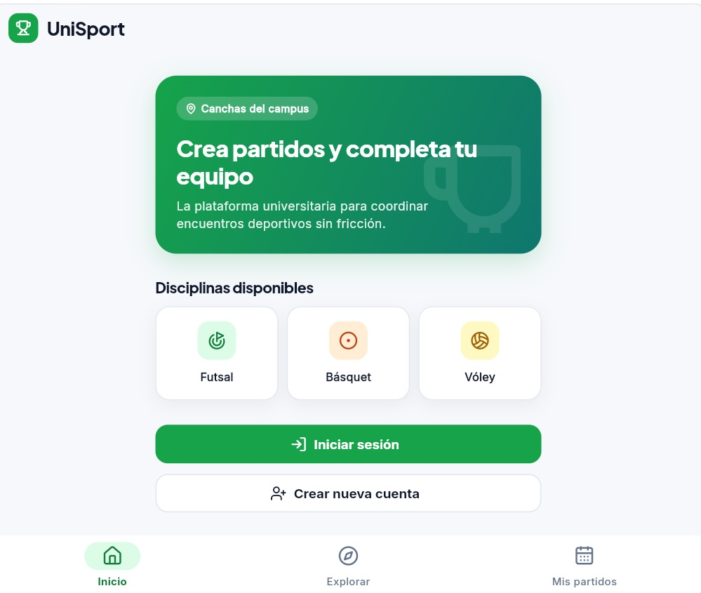
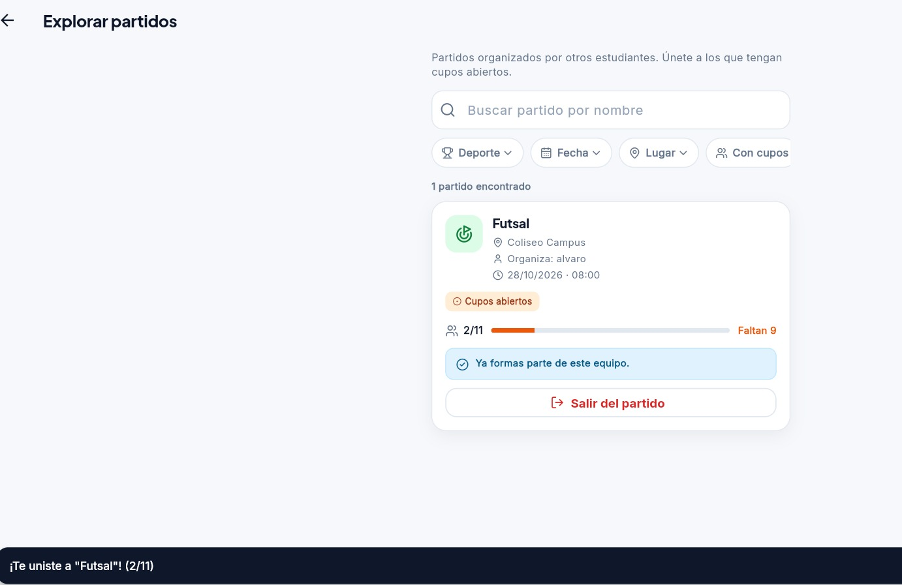
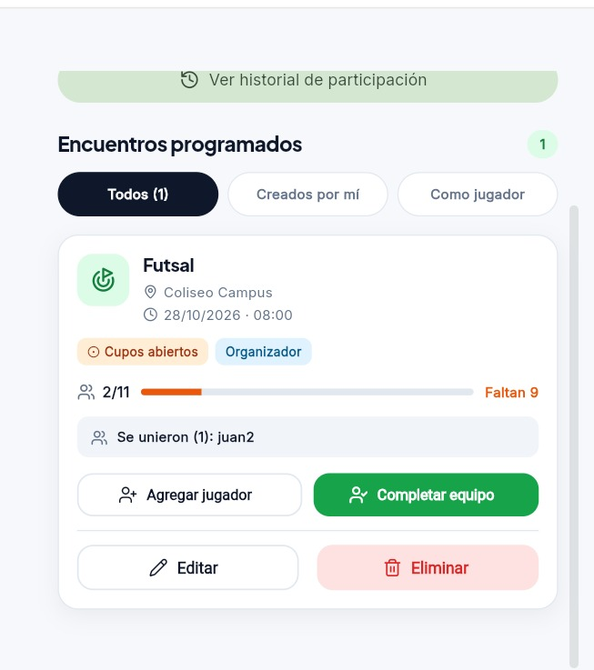

# Clase 17 · Código ajeno y refactoring

**Fecha del análisis:** 27 de octubre de 2026.

> Análisis del proyecto recibido, basado en el código local, las pruebas ejecutadas, las capturas de la aplicación y la persistencia confirmada manualmente por el grupo receptor. La Tarea 5 queda planificada en este documento para implementarse en una sesión posterior.

## 1. Proyecto recibido

| Dato | Información |
| --- | --- |
| Nombre del proyecto | UniSport |
| Grupo anterior e integrantes | Lorgio Leonardo Choque Severiche y Diego Astete Paz (Choque S. / Astete en la asignación) |
| Grupo receptor e integrantes | Alvaro Sonco Guzman y Juan Carlos Laura Cespedes |
| Enlace al repositorio recibido | [Lorgio09/Segundo-Proyecto-IHC](https://github.com/Lorgio09/Segundo-Proyecto-IHC) |
| Repositorio de trabajo del grupo receptor | [alvaroSG34/Segundo-Proyecto-IHC](https://github.com/alvaroSG34/Segundo-Proyecto-IHC) |
| Rama y commit base analizados | `main`, `f098dea6245c1a9a59a7f823914000bdf4889c71` |
| Tecnologías utilizadas | Flutter y Dart; Supabase Auth y PostgreSQL; interfaz con Material, Google Fonts y Lucide Icons |

**Propósito del proyecto:** permitir que estudiantes organicen partidos deportivos en el campus, definan disciplina, cancha y horario, y completen equipos mediante inscripciones de otros estudiantes.

**Identificación de la entrega:** las dos últimas columnas de la asignación indican el grupo anterior y el repositorio recibido. Los nombres completos coinciden con el [README](../README.md) y la [ficha del proyecto](../docs/project-card.md). El remoto local `upstream` apunta al repositorio de Lorgio09 y `origin` al repositorio de trabajo de alvaroSG34. El análisis considera también los ajustes locales de ejecución y configuración; el commit identifica la base recibida.

## 2. Ejecución del proyecto

**Entorno utilizado:** Windows, Flutter 3.47.0, Dart 3.13.0 y Google Chrome. La aplicación usa la URL y la clave pública del proyecto Supabase definidas en [configuracion_supabase.dart](../lib/config/configuracion_supabase.dart); no se reproducen credenciales en este documento.

**Comandos utilizados**, desde la raíz del proyecto (`Segundo-Proyecto-IHC`):

```powershell
flutter --version
flutter devices
flutter pub get
flutter run -d chrome --no-pub --web-hostname localhost --web-port 8080
```

**Inconvenientes y solución aplicada:** el proyecto exigía Dart `^3.13.1` y el equipo tenía Dart 3.13.0. Se ajustó el requisito mínimo a `^3.13.0` en `pubspec.yaml` y se actualizó `pubspec.lock`, conservando las versiones de los paquetes. La instalación resolvió y descargó las dependencias, pero terminó avisando que Windows requiere soporte de enlaces simbólicos para los plugins. La ejecución web con `--no-pub` compiló y continuó correctamente.

**Evidencia de ejecución registrada:** el servidor respondió HTTP 200 en `http://localhost:8080`; Flutter conectó con el servicio de depuración de Chrome y registró:

```text
Starting application from main method in: org-dartlang-app:///web_entrypoint.dart.
supabase.supabase_flutter: INFO: ***** Supabase init completed *****
```

La inicialización del cliente Supabase no demuestra por sí sola que las tablas y las funciones estén desplegadas. La captura siguiente muestra la portada pública `VistaInicioPublico`, definida en [main.dart](../lib/main.dart), y las capturas del recorrido muestran el resultado de la unión a un partido.

**Captura 1 · Aplicación en ejecución: portada pública.**



La aplicación muestra Futsal, Básquet y Vóley, junto con las opciones «Iniciar sesión» y «Crear nueva cuenta». Aunque el archivo se llama `login.jpg`, la imagen corresponde a la portada, antes de abrir el formulario de acceso.

## 3. Recorrido: pantalla → acción → regla → datos

**Caso elegido:** un estudiante se une a un partido organizado por otro estudiante y el organizador consulta quién se unió.

**Condiciones iniciales del caso:** dos usuarios con sesión, un organizador y un jugador; un partido futuro con cupos abiertos; el jugador todavía no está inscrito. En las pruebas se usan Lorgio como organizador y Diego como jugador, con un repositorio en memoria.

**Datos del recorrido capturado:** partido «Futsal», organizado por `alvaro`, en Coliseo Campus, para el 28/10/2026 a las 08:00. El jugador inscrito aparece como `juan2`. Estos usuarios corresponden a las capturas y son distintos de los usados en las pruebas automatizadas.

| Paso | Comportamiento identificado | Archivo real y clase, función o método |
| --- | --- | --- |
| Pantalla | En Explorar se consultan partidos de otros organizadores y se presenta la tarjeta con la acción disponible | [vista_explorar_partidos.dart](../lib/vistas/vista_explorar_partidos.dart): `VistaExplorarPartidos`, `_cargar()`; [tarjeta_partido.dart](../lib/widgets/tarjeta_partido.dart): `TarjetaPartido` |
| Acción | Pulsar «Unirme al equipo», confirmar «Sí, unirme» y enviar la solicitud al repositorio | [vista_explorar_partidos.dart](../lib/vistas/vista_explorar_partidos.dart): `_unirse()`; [repositorio_partidos.dart](../lib/servicios/repositorio_partidos.dart): `unirseAPartido()` |
| Regla | Rechazar si ya pertenece al equipo, es el organizador, pasó la fecha, el equipo está completo o no quedan cupos | [modelo_partido.dart](../lib/modelos/modelo_partido.dart): `puedeUnirse`, `motivoRechazoUnirse`, `motivoBloqueoAgregarJugador`; [esquema.sql](../supabase/esquema.sql): `unirse_a_partido()` |
| Datos | Llamar a la función SQL, insertar la inscripción e incrementar los cupos ocupados; el último cupo completa el equipo | [repositorio_supabase.dart](../lib/servicios/repositorio_supabase.dart): `unirseAPartido()`, `_llamar()`; [esquema.sql](../supabase/esquema.sql): tablas `partidos`, `perfiles`, `inscripciones` y función `unirse_a_partido()` |

**Regla en el servidor:** la función SQL comprueba la sesión, bloquea la fila del partido con `FOR UPDATE`, repite las validaciones e inserta la relación. La clave primaria compuesta `(partido_id, jugador_id)` evita duplicados. Las políticas RLS permiten lecturas con sesión y la inscripción se realiza mediante la función del servidor.

**Resultado previsto por el código:** Explorar actualiza la tarjeta y muestra el mensaje de éxito con los cupos. En [vista_mis_partidos.dart](../lib/vistas/vista_mis_partidos.dart), `_cargarPartidos()` obtiene las inscripciones mediante `obtenerJugadoresInscritos()` y las pasa a `TarjetaPartido.jugadoresUnidos`. El organizador ve, por ejemplo, «Se unieron (1): Diego». Esta lista se consulta al cargar o recargar la pantalla; no se identificó una suscripción en tiempo real en este recorrido.

**Captura 2 · Resultado de unirse al partido desde Explorar.**



La tarjeta muestra «Ya formas parte de este equipo», permite «Salir del partido» y registra **2/11 cupos ocupados**. El aviso inferior confirma: «¡Te uniste a "Futsal"! (2/11)».

**Captura 3 · El organizador consulta la lista de jugadores.**



La tarjeta del mismo partido muestra el rol **Organizador**, **2/11 cupos ocupados** y «Se unieron (1): juan2». Ambas capturas coinciden en título, ubicación, fecha, hora y cupos, y respaldan la unión y la consulta de la lista de jugadores.

**Comprobación manual de persistencia realizada:** el grupo receptor ejecutó la aplicación y confirmó que la información del flujo se conserva al volver a consultar la aplicación. Se registra esta verificación a partir de la confirmación del integrante que realizó la prueba.

Las capturas 2 y 3 documentan la inscripción y la lista del organizador para el mismo partido, con el jugador `juan2` y **2/11 cupos ocupados**. La confirmación manual de persistencia complementa esas imágenes. El código utiliza PostgreSQL para guardar la relación; las 30 pruebas automatizadas descritas más adelante usan memoria y verifican un alcance distinto.

## 4. Impacto para implementar la Tarea 5

**Requisito de la clase:** agregar una relación que antes no existía en el proyecto recibido. El resultado debe mantenerse después de recargar o volver a entrar.

**Funcionalidad indicada para UniSport:** «Unirse a un partido y mostrar la lista actualizada de jugadores».

**Situación actual encontrada:** la relación ya está implementada en la versión recibida. Existen la tabla `inscripciones`, el método `unirseAPartido()`, la función `unirse_a_partido()` y la lista de jugadores en la tarjeta del organizador. También existen pruebas de estas operaciones. Por tanto, esta funcionalidad debe documentarse como comportamiento heredado, sin atribuirla al grupo receptor como una relación nueva.

**Relación identificada:** `perfiles` ↔ `partidos`, de muchos a muchos mediante `inscripciones`. Cada fila relaciona un jugador con un partido. El organizador se registra en `partidos.organizador_id` y cuenta inicialmente como un cupo ocupado; la lista de inscripciones muestra a quienes se unieron desde Explorar.

**Propuesta para la Tarea 5: invitar a un estudiante a un partido.** Puesto que la unión directa y la lista de jugadores ya existen, se propone agregar una relación de invitación entre un partido y un estudiante que todavía no participa. El organizador envía la invitación y el destinatario puede aceptarla o rechazarla. Aceptar crea la inscripción mediante las reglas existentes; rechazar conserva la respuesta sin ocupar un cupo. Esta ampliación se propone para cubrir la exigencia de una relación nueva y se implementará en otra sesión.

**Diferencia entre las relaciones:** `inscripciones` representa la participación efectiva; la nueva relación `invitaciones` representará una convocatoria individual y su respuesta. Una invitación pendiente no significa que el estudiante ya esté inscrito.

**Recorrido futuro:** Mis partidos del organizador → Invitar estudiante → guardar invitación pendiente → el destinatario consulta sus invitaciones → acepta o rechaza → guardar respuesta y actualizar la participación cuando corresponda.

**Cambios previstos y archivos afectados:**

| Área | Archivo o componente real | Cambio necesario |
| --- | --- | --- |
| Interfaz del organizador | Modificar `lib/widgets/tarjeta_partido.dart` y `lib/vistas/vista_mis_partidos.dart`; crear `lib/vistas/vista_invitar_jugador.dart` (archivo propuesto) | Incorporar «Invitar estudiante» para partidos propios, permitir seleccionar un estudiante registrado y mostrar confirmación o el motivo del rechazo |
| Interfaz del destinatario | Crear `lib/vistas/vista_invitaciones.dart` (archivo propuesto) y agregar su acceso desde `lib/vistas/vista_mis_partidos.dart` | Listar invitaciones pendientes y respondidas, mostrar partido y organizador, y ofrecer «Aceptar» y «Rechazar» con estados de carga y mensajes de resultado |
| Modelo de invitación | Crear `lib/modelos/modelo_invitacion.dart` (archivo propuesto) | Representar identificador, partido, destinatario, estado (`pendiente`, `aceptada`, `rechazada`) y fechas de creación y respuesta |
| Contrato de datos | Modificar `lib/servicios/repositorio_partidos.dart` | Declarar operaciones para consultar estudiantes elegibles, enviar invitaciones, listar las recibidas y enviadas, y responderlas |
| Acceso a Supabase | Modificar `lib/servicios/repositorio_supabase.dart` | Implementar las operaciones, convertir filas al nuevo modelo y reutilizar el manejo de errores existente para presentar los mensajes del servidor |
| Persistencia y permisos | Modificar `supabase/esquema.sql` | Crear `invitaciones`, sus claves foráneas, unicidad por partido y destinatario, estados válidos, políticas RLS y funciones SQL de envío y respuesta |
| Regla de aceptación | Reutilizar `unirse_a_partido()` en `supabase/esquema.sql`; conservar las reglas de `lib/modelos/modelo_partido.dart` | Aceptar la invitación y registrar la inscripción en una misma transacción, reutilizando la unión existente para validar cupos, fecha y pertenencia al equipo |
| Actualización de pantallas | Modificar `lib/vistas/vista_mis_partidos.dart` y las vistas nuevas propuestas | Volver a consultar invitaciones, partidos y jugadores después de cada operación y al regresar a Mis partidos; consultar los datos persistidos al volver a entrar |
| Pruebas | Extender `test/apoyo/repositorio_en_memoria.dart`; crear `test/invitaciones_test.dart` y `test/vista_invitaciones_test.dart` (archivos propuestos) | Cubrir envío, permisos, respuestas, rechazo de duplicados y aceptación sin doble incremento de cupos; repetir las pruebas existentes del flujo de unión |

Los archivos indicados como propuestos todavía no existen. Esta sección define el impacto esperado; no registra funcionalidades implementadas.

**Datos que deberá persistir la relación propuesta:**

- `id`: identificador de la invitación.
- `partido_id`: referencia a `partidos.id`.
- `destinatario_id`: referencia a `perfiles.id`.
- `estado`: `pendiente`, `aceptada` o `rechazada`.
- `creado_en` y `respondido_en`: fechas del envío y de la respuesta.

El remitente se obtiene de `partidos.organizador_id`. Se propone una restricción única sobre `(partido_id, destinatario_id)` y eliminar las invitaciones asociadas si se elimina el partido o el destinatario. Las invitaciones y sus respuestas se almacenarán en Supabase, además de reflejarse en la interfaz.

**Reglas previstas:**

1. Solo el organizador puede enviar invitaciones a su partido. No puede invitarse a sí mismo ni invitar a quien ya participa.
2. No se admiten invitaciones duplicadas para el mismo partido y estudiante. En este alcance inicial no se incluye el reenvío de invitaciones rechazadas.
3. Solo el destinatario puede aceptar o rechazar una invitación pendiente. El organizador y el destinatario pueden consultar las invitaciones que les corresponden mediante políticas RLS.
4. Enviar una invitación no ocupa ni reserva un cupo. El partido debe admitir jugadores al enviarla y se vuelven a comprobar los cupos y la fecha al aceptarla.
5. La aceptación utilizará la función de unión existente dentro de la misma transacción que cambia el estado de la invitación. Si el partido ya pasó, se completó o el estudiante ya se unió directamente, se informa el motivo y no se agrega otra inscripción ni se modifica el contador.
6. Si dos estudiantes intentan aceptar el último cupo, el bloqueo de la fila del partido permitirá que solo uno lo ocupe. Una respuesta ya registrada no podrá procesarse por segunda vez.
7. Rechazar guardará el estado `rechazada` sin cambiar los jugadores ni los cupos del partido.
8. Las operaciones de escritura se realizarán mediante funciones SQL que validen estas reglas. La interfaz deshabilitará acciones mientras se procesan y actualizará sus datos al terminar.

**Criterios de aceptación de la nueva funcionalidad, para verificar cuando se implemente:**

- El organizador puede enviar una invitación y el destinatario la ve como pendiente.
- Al aceptar, se guarda la respuesta, se crea una sola inscripción y el organizador ve al nuevo jugador en su lista.
- Al rechazar, la respuesta queda guardada y los cupos no cambian.
- Un usuario ajeno no puede enviar ni responder invitaciones en nombre de otros.
- Se impiden respuestas repetidas y la aceptación cuando no quedan cupos o el partido ya pasó.
- Las invitaciones, sus respuestas y la participación resultante se conservan después de recargar o volver a entrar. Esta persistencia deberá comprobarse para la relación nueva, además de la ya confirmada para las inscripciones actuales.

**Orden de implementación para la próxima sesión:** definir el modelo y el esquema, agregar las funciones SQL y sus permisos, extender los repositorios real y de pruebas, incorporar las pantallas, y ejecutar las pruebas y el recorrido manual con dos usuarios. La persistencia confirmada hoy corresponde al flujo heredado; la ampliación tendrá sus propias verificaciones.

**Criterios de aceptación del flujo de unión que deben conservarse:**

- Un jugador ajeno puede unirse a un partido futuro con cupos abiertos.
- Se crea una sola inscripción y se incrementa un cupo ocupado.
- El organizador puede consultar el nombre del jugador después de recargar.
- Se rechazan una segunda unión, un partido pasado y un equipo completo.
- Al ocupar el último cupo, el estado cambia a Equipo completo.
- La inscripción se conserva después de recargar o volver a entrar.

## 5. Refactoring y comprobación del comportamiento

Clasificación de los cambios:

- **Refactoring:** mejora la estructura y conserva el comportamiento observable.
- **Corrección:** cambia un comportamiento incorrecto para resolver un defecto.
- **Nueva funcionalidad:** agrega un comportamiento que antes no existía, como la relación de la Tarea 5.

**Estado del trabajo:** en esta etapa se documenta y verifica el código recibido; no se realizó un refactoring del flujo de unión. El ajuste del requisito del SDK corresponde a compatibilidad del entorno.

**Mejora estructural posible:** extraer la construcción de los diálogos de confirmación de `_unirse()` y `_salir()` en [vista_explorar_partidos.dart](../lib/vistas/vista_explorar_partidos.dart) a un método común. De hacerse, debe conservar textos, opciones, cancelación y llamadas al repositorio. Es una propuesta y no un cambio realizado.

**Red de seguridad ejecutada:** se usaron las pruebas existentes de la regla, del flujo entre estudiantes y de la tarjeta, sin modificar la implementación:

```powershell
flutter test --no-pub test/union_partido_test.dart test/flujo_partidos_test.dart test/tarjeta_partido_test.dart
```

**Resultado:** 30 pruebas aprobadas (`All tests passed!`). Las pruebas verifican reglas, operaciones sobre un repositorio en memoria y presentación de la tarjeta; no prueban el despliegue de Supabase ni una recarga del navegador contra datos reales.

| Verificación | Antes del refactoring | Después del refactoring |
| --- | --- | --- |
| Pruebas existentes del flujo de unión | 30 pruebas aprobadas | No aplica todavía: no se realizó refactoring |
| Recorrido manual y persistencia del flujo recibido | Unión y lista de jugadores documentadas en las capturas 2 y 3; persistencia confirmada manualmente por el grupo receptor | Repetir el mismo caso si se realiza refactoring |
| Evidencia | Salida de pruebas: `+30: All tests passed!` | Pendiente únicamente si se modifica la estructura |

Si se realiza el refactoring propuesto, se deberá repetir el mismo comando y el recorrido manual, y registrar ambos resultados. No se considera verificado el comportamiento después de un cambio que aún no se realizó.

## 6. Revisión del entregable

- [x] Identificar el grupo anterior y enlazar el repositorio recibido.
- [x] Registrar los comandos reales e incluir una captura funcionando.
- [x] Explicar un recorrido pantalla → acción → regla → datos con archivos reales.
- [x] Incluir capturas de la unión al partido y de la lista de jugadores del organizador.
- [x] Analizar el impacto de la Tarea 5 e identificar que la relación indicada ya existe.
- [x] Ejecutar las pruebas existentes del caso como referencia para cambios posteriores.
- [x] Registrar la persistencia del flujo existente, confirmada manualmente por el grupo receptor.
- [x] Documentar la propuesta de relación adicional de la Tarea 5, sus reglas, archivos afectados y criterios de aceptación.

La implementación de la Tarea 5 y las pruebas de la relación nueva quedan para una sesión posterior. El alcance de este entregable es el análisis del proyecto recibido y del impacto previsto.

**Archivo solicitado:** `evidencias/clase-17.md`.

**Mensaje de commit indicado en clase:** `docs: analizar proyecto recibido`.
