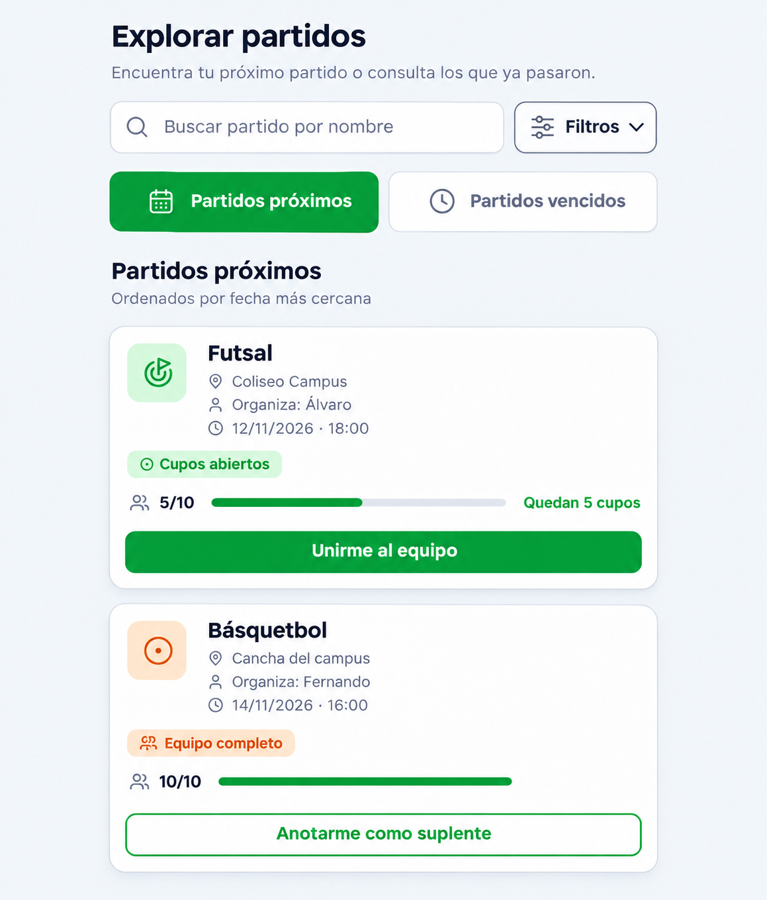
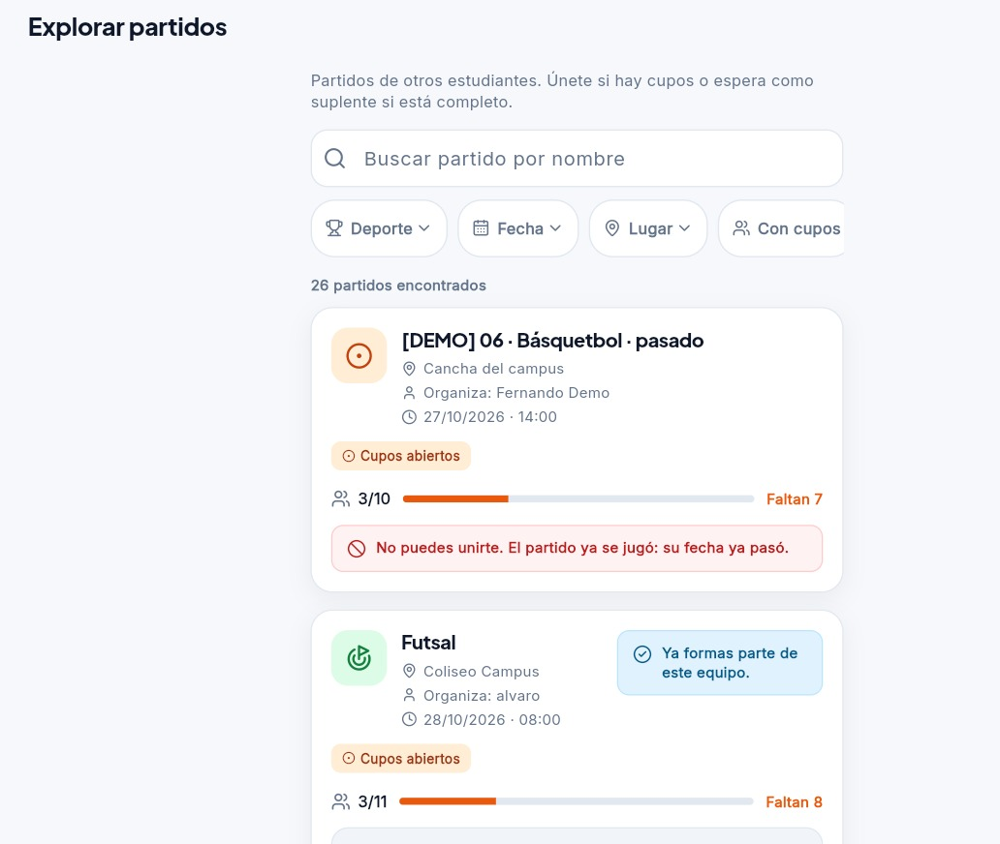
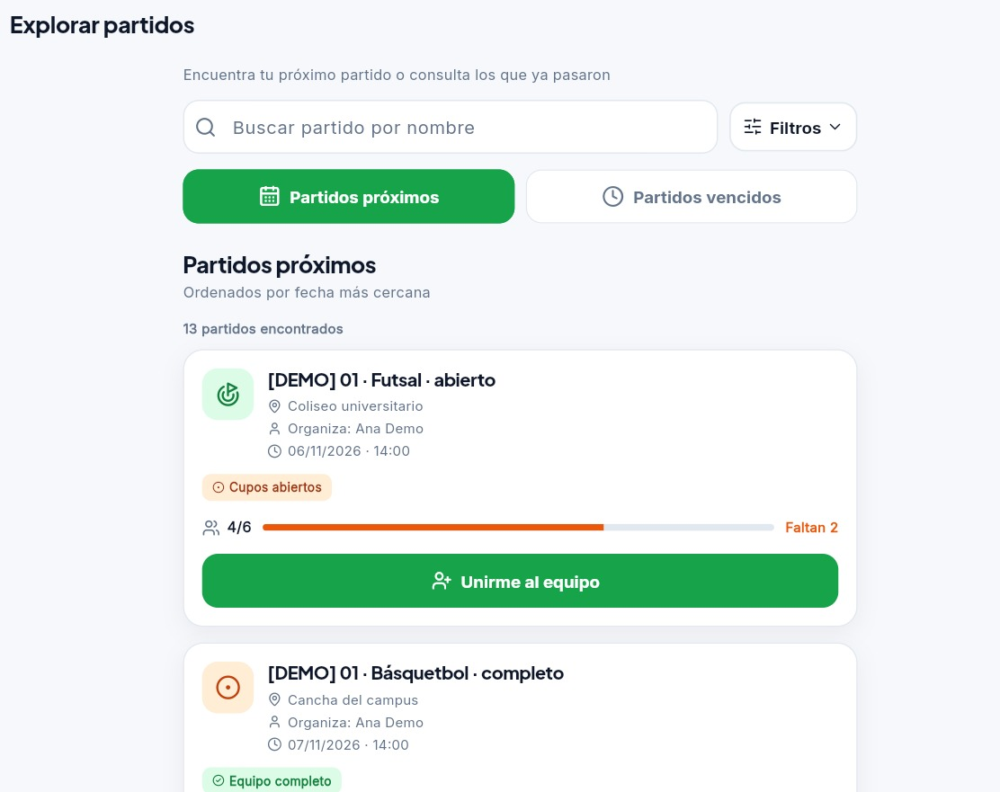

# Clase 20 · Arquitectura de información

**Proyecto:** UniSport.  
**Fecha de la actividad:** jueves 5 de noviembre de 2026.  
**Modalidad:** con IA.  
**Integrantes del grupo actual:** Alvaro Sonco Guzman y Juan Carlos Laura Cespedes, según la identificación del grupo receptor en [clase-17.md](clase-17.md).

## 1. Problema concreto y tarea elegida

En **Explorar partidos**, la lista mezclaba encuentros futuros y encuentros cuya fecha ya había pasado. La captura anterior muestra primero un partido del 27 de octubre, con el aviso de que ya no se puede participar. Para encontrar un encuentro próximo, la persona debía revisar las fechas de las tarjetas o utilizar los filtros de fecha.

Además, las opciones **Deporte**, **Fecha**, **Lugar** y **Con cupos** estaban siempre visibles, mientras que las dos consultas principales —encontrar un próximo partido o consultar los anteriores— no tenían accesos directos.

**Tarea elegida para mejorar:** encontrar un partido próximo y consultar los partidos cuya fecha ya pasó, manteniendo accesibles los filtros específicos.

## 2. Dibujo de la propuesta y motivo

La estructura propuesta mantiene el buscador, reúne las opciones específicas en un panel desplegable y ofrece dos categorías temporales visibles:

```text
Explorar partidos
Encuentra tu próximo partido o consulta los que ya pasaron

[ Buscar partido por nombre                 ] [ Filtros ▾ ]
    Al abrir Filtros: Deporte · Fecha · Lugar · Con cupos
    Si hay filtros activos: etiquetas para quitarlos y Limpiar todo

[ Partidos próximos ] [ Partidos vencidos ]

Nombre de la categoría seleccionada
Orden de los resultados · Cantidad de partidos encontrados

[ Tarjeta del partido: fecha, lugar, cupos y acciones ]
[ Tarjeta del partido: fecha, lugar, cupos y acciones ]
```

**Prototipo de la propuesta**, generado con IA como referencia visual antes de la implementación:



**Motivo de la decisión:** agrupar los partidos según la tarea de la persona facilita distinguir qué encuentros todavía están por realizarse y cuáles ya pasaron. Los nombres de las categorías anticipan su contenido. El botón **Filtros** permite acceder a deporte, fecha, lugar y cupos cuando se necesitan, y las etiquetas activas explican por qué se están mostrando determinados resultados.

## 3. Implementación realizada

- La pantalla abre en **Partidos próximos**, ordenados por la fecha más cercana. **Partidos vencidos** muestra primero los encuentros más recientes. La clasificación utiliza fecha y hora: próximos incluye el instante de consulta y vencidos contiene fechas anteriores.
- El botón **Filtros** abre y cierra el panel de opciones. Por debajo de 400 px de ancho disponible se coloca debajo del buscador, alineado a la derecha.
- La búsqueda, los filtros y la categoría se conservan durante la sesión al salir y volver a Explorar. Cerrar el panel conserva los valores elegidos y mantiene visibles las etiquetas activas.
- **Limpiar todo** y **Quitar filtros** eliminan la búsqueda y los filtros conservando la categoría seleccionada.
- Al entrar a vencidos se quita **Con cupos** y se deshabilita su control con el mensaje **Disponible solo en partidos próximos**. Al volver a próximos queda habilitado y desmarcado.
- Los estados vacíos distinguen entre **No hay partidos próximos**, **No hay partidos vencidos** y una búsqueda sin coincidencias. Las tarjetas conservan sus acciones de inscripción y suplentes.
- Las consultas a Supabase aplican la categoría y el orden junto con los demás filtros. No se requieren migraciones de base de datos.

**Archivos principales afectados:** [vista_explorar_partidos.dart](../lib/vistas/partidos/vista_explorar_partidos.dart), [panel_filtros.dart](../lib/widgets/panel_filtros.dart), [filtro_partidos.dart](../lib/modelos/filtro_partidos.dart), [controlador_explorar.dart](../lib/servicios/partidos/controlador_explorar.dart) y [repositorio_partidos_supabase.dart](../lib/servicios/partidos/repositorio_partidos_supabase.dart).

## 4. Capturas de antes y después

### Antes

Lista con 26 partidos encontrados, filtros específicos visibles y un partido pasado al inicio de los resultados.



### Después

Vista de **Partidos próximos** con 13 resultados, el botón **Filtros** y los dos accesos temporales. La primera tarjeta muestra un encuentro del 6 de noviembre con la acción **Unirme al equipo**.



## 5. Verificación técnica

Durante la implementación se ejecutaron:

```powershell
flutter --suppress-analytics --no-version-check analyze --no-pub
flutter --suppress-analytics --no-version-check test --no-pub
```

**Resultado:** análisis estático sin incidencias; **136 pruebas aprobadas y 1 omitida**. La prueba omitida es la integración con Supabase que requiere activación explícita. El recorrido E2E real se adaptó para abrir el panel mediante **Filtros**, pero su ejecución queda pendiente de las credenciales de dos cuentas de prueba.

Las pruebas de [periodo_partidos_test.dart](../test/periodo_partidos_test.dart) verifican el límite temporal, las condiciones de consulta y el orden de las categorías. Las de [explorar_periodos_test.dart](../test/explorar_periodos_test.dart) y [panel_filtros_test.dart](../test/panel_filtros_test.dart) comprueban la conservación y limpieza de filtros, sus controles y el diseño a 320 y 1280 px. También pasó la suite anterior de navegación, inscripción y suplentes.

## 6. Enlace al commit

La mejora de arquitectura de información y su evidencia quedaron registradas en
[7d14d1c — fix de la clase 20](https://github.com/alvaroSG34/Segundo-Proyecto-IHC/commit/7d14d1cca88bd410bef72d76b2e6744ef0464d41).
