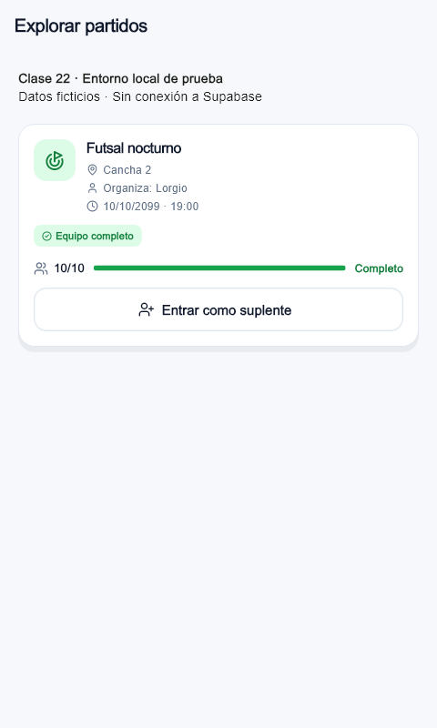
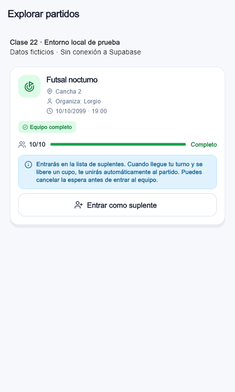

# Clase 22 · Patrones oscuros: información antes de entrar como suplente

**Proyecto:** UniSport.
**Fecha:** 12 de noviembre de 2026 (America/La_Paz).
**Modalidad:** Sin IA.
**Integrantes:** Alvaro Sonco Guzman y Juan Carlos Laura Cespedes.

## 1. Checklist y problema elegido

Revisión estática de registro, acceso, partidos, suplentes, equipos y cierre de sesión. No se verificó el servidor desplegado ni se ejecutó un E2E contra Supabase.

| Criterio de clase | Observación en el código | Evaluación |
| --- | --- | --- |
| Opciones preseleccionadas | El registro selecciona Futsal por defecto. No se encontraron casillas de permisos o promociones preactivadas. | Preferencia asumida; no basta para demostrar manipulación. |
| Confirmaciones engañosas | Unirse, salir y eliminar tienen acciones explícitas y permiten cancelar. El rótulo de baja tardía podría mencionar también que se sale del partido. | Sin engaño comprobado; posible mejora de claridad. |
| Urgencia, culpa o escasez falsas | Los cupos dependen del partido y la baja tardía de su hora de inicio. | Sin evidencia de escasez artificial o mensajes de culpa. |
| Datos expuestos sin necesidad | La política SELECT de perfiles permite leer filas ajenas; contienen correos. | Requiere verificar privilegios efectivos en Supabase. No corregido en esta entrega. |
| Salir más difícil que entrar | Unirse y salir del partido requieren dos toques desde la tarjeta; entrar y cancelar espera requieren uno. No se encontró eliminación de cuenta. | El flujo de partidos conserva simetría; eliminación de cuenta pendiente. |
| Permisos sin explicar | No se encontraron solicitudes de ubicación, cámara o contactos. La analítica se activa sin aviso o control visible en las vistas revisadas. | Transparencia de analítica pendiente; no equivale a un permiso del dispositivo. |

**Problema elegido:** en Explorar partidos, una persona que encuentra un equipo completo ve «Entrar como suplente», pero la explicación de que se incorporará automáticamente al liberarse un cupo solo aparece después de entrar en espera.

**Ubicación anterior:** `lib/widgets/tarjeta_partido.dart`, líneas 452–463 de la revisión base `58587d7`. La explicación posterior estaba en las líneas 435–436.

La automatización beneficia a la organización del partido porque completa cupos sin otra interacción. Antes de decidir, la persona no recibe una explicación de que entrar en espera puede terminar en una inscripción automática. Es una consecuencia comunicada tarde, relacionada con información oculta y control del usuario; no se afirma intención manipuladora ni se fuerza su clasificación como permiso del dispositivo.

## 2. Antes

La tarjeta ofrecía entrar en espera sin explicar antes la promoción automática:

```dart
] else if (partido.puedeEntrarEnEspera &&
    onEntrarEnEspera != null) ...[
  const SizedBox(height: 12),
  OutlinedButton.icon(
    onPressed: onEntrarEnEspera,
    icon: const Icon(LucideIcons.userPlus, size: 18),
    label: const Text('Entrar como suplente'),
    // Estilo del botón conservado en la corrección.
  ),
]
```



## 3. Después

En `lib/widgets/tarjeta_partido.dart:455` se agregó un aviso informativo inmediatamente antes del botón, usando el mismo estilo de avisos de la tarjeta:

```dart
_avisoUnion(
  'Entrarás en la lista de suplentes. Cuando llegue tu turno y se libere '
  'un cupo, te unirás automáticamente al partido. Puedes cancelar la '
  'espera antes de entrar al equipo.',
  icono: LucideIcons.info,
  fondo: TemaApp.azulSuave,
  borde: const Color(0xFFBAE6FD),
  color: const Color(0xFF075985),
),
const SizedBox(height: 8),
```



El aviso solo aparece cuando se ofrece entrar como suplente. Se conservan el turno, la explicación posterior y «Cancelar espera». Entrar y cancelar siguen requiriendo un toque cada uno, sin diálogos nuevos. No se cambiaron reglas, interfaces, analítica ni esquema de Supabase.

Las dos imágenes son renderizados reales del widget en un fixture local de 480 × 800, con el mismo partido ficticio completo de 10/10 cupos. No representan cuentas reales ni datos del servidor. Para hacer legible el texto se cargó Arial instalada en Windows en lugar de las fuentes remotas, conservando los iconos del proyecto. La sustitución ocurre únicamente en el fixture y puede alterar ligeramente la tipografía respecto de la aplicación.

## 4. Principio aplicado

**Decisión informada y transparencia:** la consecuencia de inscribirse automáticamente se explica antes de elegir entrar en la lista.

**Nielsen #3, control y libertad del usuario:** el aviso comunica que se puede cancelar la espera antes de entrar al equipo. La acción existente permanece accesible y no se añaden confirmaciones que dificulten entrar o salir.

## 5. Pruebas y resultados

Pruebas en `test/tarjeta_partido_test.dart`:

- `informa antes de entrar como suplente a 320.0 px` y `a 1280.0 px`: el aviso existe antes del toque, está por encima del botón, ambos son alcanzables y no hay errores de layout; no se ha ejecutado la inscripción. Un toque invoca la acción exactamente una vez y no abre un diálogo.
- `el aviso previo solo acompaña la oferta de suplente`: no aparece para organizadores, inscritos, suplentes actuales, equipos con cupos o tarjetas sin acción de entrada.
- Se conservan las pruebas existentes de turno, cancelación, promoción automática y orden de suplentes.

### Fallo antes de corregir

Se añadieron primero las pruebas y se ejecutaron contra la tarjeta anterior:

```powershell
flutter --suppress-analytics --no-version-check test --no-pub test/tarjeta_partido_test.dart --plain-name 'informa antes de entrar como suplente' --reporter expanded
```

**Resultado:** 0 aprobadas y 2 fallidas. Ambas fallaron al buscar el aviso inexistente, antes de ejecutar la acción.

### Éxito después de corregir

```powershell
flutter --suppress-analytics --no-version-check test --no-pub test/tarjeta_partido_test.dart --reporter expanded
flutter --suppress-analytics --no-version-check test --no-pub --reporter expanded
flutter --suppress-analytics --no-version-check analyze --no-pub
```

**Resultado de la tarjeta:** 21 pruebas aprobadas, incluidas las dos que fallaban antes.

**Suite local:** 244 aprobadas, 2 omitidas, sin fallos. Las omitidas son la integración con Supabase, que requiere activación explícita, y el fixture visual, que se activa por separado.

**Análisis estático:** sin incidencias en la ejecución final.

### Capturas reproducibles

Fixture: `test/evidencias_clase22_test.dart`. No agrega rutas ni pantallas al producto y se omite en la suite normal. Para regenerar el después:

```powershell
flutter --suppress-analytics --no-version-check test --no-pub test/evidencias_clase22_test.dart --update-goldens --dart-define=CLASE22_CAPTURA=despues --reporter expanded
```

Para reproducir el antes, ejecutar el mismo fixture sobre la tarjeta de la revisión base `58587d7`, en un checkout aislado, usando `--dart-define=CLASE22_CAPTURA=antes`. La captura anterior de esta entrega se regeneró quitando temporalmente solo el bloque nuevo y restaurándolo al terminar. El parámetro nombra la imagen; no simula la versión anterior.

El fixture usa `C:/Windows/Fonts/arial.ttf`; en otro entorno se debe proporcionar una fuente local mediante `--dart-define=CLASE22_FUENTE=/ruta/fuente.ttf`. Ambas ejecuciones visuales pasaron. Los mensajes de carga remota de Google Fonts corresponden al entorno de pruebas; las imágenes se inspeccionaron y tienen texto legible gracias a la fuente local.

## 6. Commit dedicado

Este documento, la corrección, las pruebas y las imágenes se incluyen juntos en el commit:

`fix(etica): informar la inscripcion automatica de suplentes`

Referencia reproducible al commit de la entrega:

```powershell
git log -1 --format='%h %s' --grep='^fix(etica): informar la inscripcion automatica de suplentes$'
```

El cambio previo de `evidencias/tarea-9.md` queda fuera de este commit. No se desplegaron cambios ni se ejecutó un E2E contra Supabase.
