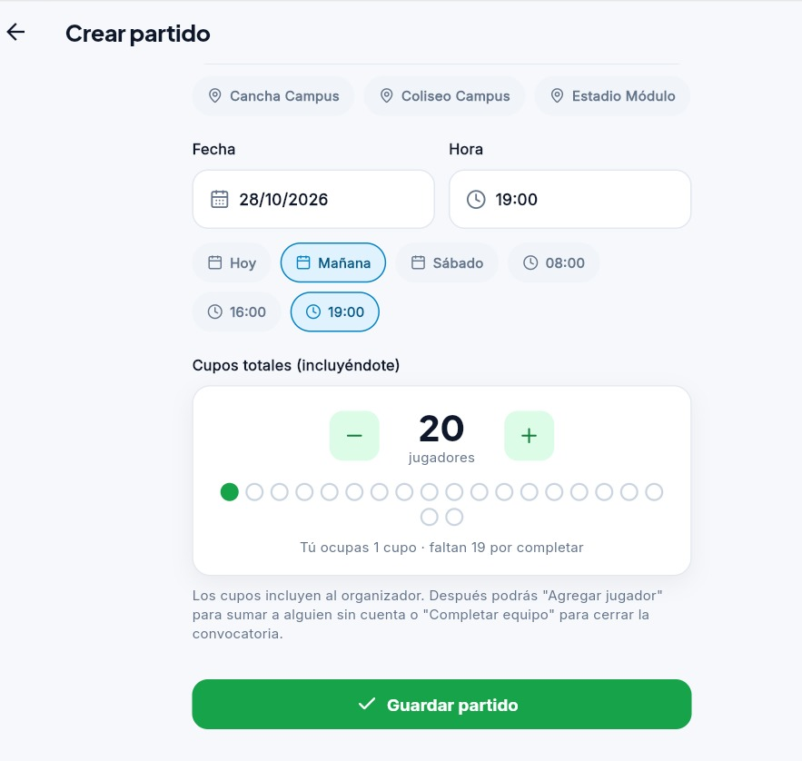
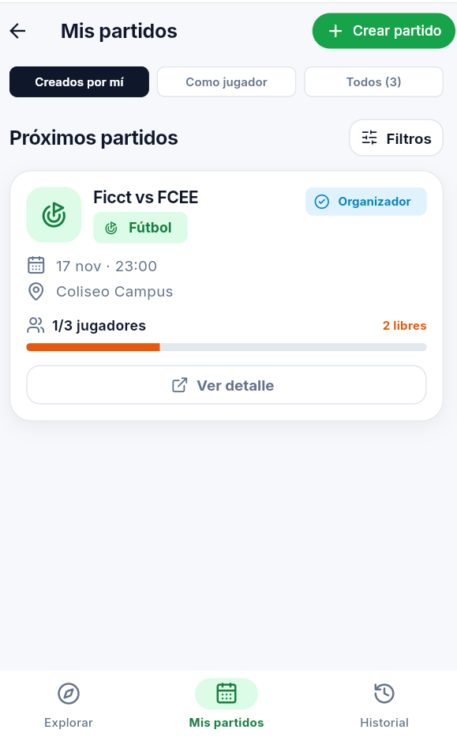

# Clase 23 · Inventario y tokens

**Proyecto:** UniSport  
**Fecha:** 17 de noviembre de 2026  
**Modalidad:** Sin IA
**Integrantes:** Alvaro Sonco Guzman y Juan Carlos Laura Cespedes.

## 1. Inventario de botones

### Capturas comparativas

| A · Crear partido: «Guardar partido» | B · Mis partidos: «Crear partido» en la barra superior |
| --- | --- |
|  |  |

### Diferencias señaladas

1. **Tamaño y ubicación:** «Guardar partido» ocupa todo el ancho del formulario. «Crear partido» es compacto y aparece como acción de la pantalla Mis partidos.
2. **Forma y contenido:** «Guardar partido» es rectangular con esquinas redondeadas. «Crear partido» tiene forma de píldora e incluye el icono `+`.
3. **Estado visible:** la captura de «Guardar partido» muestra el check de confirmación; «Crear partido» muestra su estado normal.

Ambos usan el verde de acción y texto blanco. La diferencia de tamaño corresponde a sus funciones: guardar el formulario y comenzar la creación desde otra pantalla.

## Inventario breve

| Pantalla | Botón | Tipo / tratamiento visible |
| --- | --- | --- |
| Crear partido | Guardar partido | Primario, ancho completo; muestra carga y confirmación. |
| Mis partidos | Crear partido | Primario compacto, con icono `+`. |
| Inicio público | Iniciar sesión | Primario, ancho completo, con icono. |
| Inicio público | Crear nueva cuenta | Secundario delineado, ancho completo. |
| Tarjeta de partido | Eliminar | Acción destructiva, texto y fondo rojos. |

## Referencias de implementación

- «Guardar partido»: `lib/vistas/partidos/vista_crear_partido.dart` y `lib/widgets/boton_accion.dart`.
- «Crear partido»: `lib/vistas/partidos/vista_mis_partidos.dart`.
- Tipos primario y secundario globales: `lib/tema/tema_app.dart`.

## 2. Tokens de color

La paleta clara está definida en [`lib/tema/tema_app.dart`](../lib/tema/tema_app.dart). La columna oscura propone equivalentes semánticos para un futuro tema; **esos valores todavía no están implementados ni se aplican en la interfaz**.

| Token (nombre por función) | Claro (actual) | Oscuro (propuesto) | Función y ejemplos de uso |
| --- | --- | --- | --- |
| `fondo` | `#F6F8FB` | `#0B1220` | Lienzo detrás de tarjetas y controles. Se establece en el `scaffoldBackgroundColor` del tema; aparece, por ejemplo, en Inicio y Nueva clave (`vista_principal.dart`, `vista_nueva_clave.dart`). El valor oscuro es un azul casi negro para separar el fondo de las superficies. |
| `superficie` | `#FFFFFF` | `#111827` | Superficies que se colocan encima del fondo: tarjetas, campos y diálogos. Alimenta el relleno de campos y los temas de diálogo y tarjeta; también se usa en filtros y detalles de partido (`panel_filtros.dart`, `vista_detalle_partido.dart`). En oscuro, el gris azulado diferencia estas superficies sin usar blanco brillante. |
| `textoPrincipal` | `#0F172A` | `#F8FAFC` | Texto que debe leerse primero: títulos, nombres de partidos y contenido principal. Se usa, entre otros, en el AppBar y en tarjetas de partidos e historial (`tema_app.dart`, `tarjeta_partido.dart`, `tarjeta_historial.dart`). En oscuro pasa a casi blanco para mantener legibilidad sobre `superficie`. |
| `textoSecundario` | `#64748B` | `#94A3B8` | Información de apoyo: ubicaciones, fechas, ayudas, etiquetas e iconos secundarios. Es frecuente en las tarjetas de partidos, filtros, formularios y detalles. En oscuro se aclara respecto al valor principal, conservando una jerarquía visual sin competir con los títulos. |
| `verdeDeportivo` | `#16A34A` | `#15803D` | Color de acción y marca: botones primarios, selecciones activas e indicadores. El tema lo aplica a `ElevatedButton`; también aparece en `BotonAccion`, filtros seleccionados y acciones de Mis partidos (`tema_app.dart`, `boton_accion.dart`, `vista_explorar_partidos.dart`, `vista_mis_partidos.dart`). En oscuro se propone `#15803D`, verde ya presente como `verdeOscuro`, para mantener texto blanco legible en botones. |

### Cómo leer la tabla

- **Claro (actual)** refleja los valores presentes en `TemaApp`; son los que usa la app hoy.
- **Oscuro (propuesto)** es una decisión de diseño para documentar cómo podría adaptarse cada función. No representa un modo oscuro funcional.
- Los nombres describen **para qué sirve** cada color, no su apariencia. Así, un componente consulta `textoSecundario` en vez de repetir un gris hexadecimal.
- `superficie` debe seguir siendo perceptiblemente distinta de `fondo`; `textoPrincipal` y `textoSecundario` deben mantener una jerarquía legible; y `verdeDeportivo` debe permitir reconocer las acciones principales.

Antes de implementar el tema oscuro, habría que definir un `ThemeData` para `Brightness.dark`, revisar los componentes que tienen colores escritos directamente y verificar contraste y estados normales, seleccionados, deshabilitados y de error. Esta tabla no cambia el código ni afirma que ya se hayan validado esos contrastes.

## 3. Conteo de colores fijos en una pantalla

**Pantalla revisada:** Inicio principal, implementada en `lib/vistas/inicio/vista_principal.dart`.

**Búsqueda realizada:** expresiones `Color(0x...)` y `Colors.*` dentro del archivo de esta pantalla, equivalente a filtrar la búsqueda global de VS Code por ese archivo. No conté referencias a `TemaApp`, colores heredados del tema ni colores de otras pantallas.

| Tipo de expresión | Cantidad de apariciones | Valores encontrados |
| --- | ---: | --- |
| `Color(0x...)` | 8 | `#0BAA60`, `#10786F`, `#E0F2EA`, `#26C99A`, `#0077A8`, `#F59E0B`, `#7C3AED`, `#475569` |
| `Colors.white` | 5 | Blanco opaco en cuatro usos y blanco al 18 % de opacidad en uno. |
| **Total** | **13 expresiones de color fijas** | **9 colores base distintos**, más una variante semitransparente de blanco. |

Si se cuenta solo el patrón hexadecimal `Color(0x...)` indicado en clase, el resultado es **8 apariciones**. Se anotan aparte los cinco usos de `Colors.white` porque también fijan un color, aunque estén escritos como constantes con nombre.

Los hexadecimales se encuentran en el degradado del perfil, el texto del perfil y los botones de acceso a Crear partido, Mis partidos, Explorar, Historial y Analítica. `Colors.white` se usa en esos elementos para texto, iconos y fondos. **Este apartado solo registra lo encontrado; no se modificó ningún color**, tal como indica la consigna.
