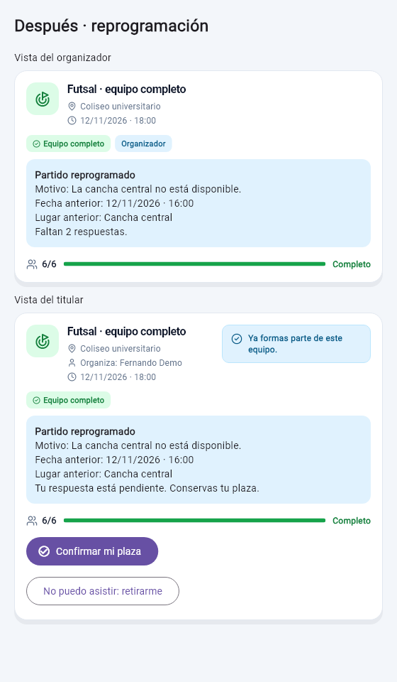

# Tarea 7 · Mejoras a partir del feedback recibido

**Feedback recibido:** [Feedback de Alejandro de los Ríos](https://github.com/Alejandrodelosrios/app-p2-ihc/blob/main/clase-19-feedback-a-otro-proyecto/feedback.md)

El evaluador tuvo dificultades para orientarse desde la portada pública y observó que «Agregar jugador» aumentaba el contador sin añadir a nadie a la lista de jugadores.

## Cambios realizados

1. **Portada más clara.** Quitamos la barra inferior que podía llevar a opciones protegidas por inicio de sesión. La portada conserva «Iniciar sesión» y «Crear nueva cuenta».
   - **Evidencia:** [`test/navegacion_explorar_test.dart`](../test/navegacion_explorar_test.dart) comprueba que la portada no muestre la barra y mantenga ambos botones.
   - **Commit:** [`bf9ed5c`](https://github.com/alvaroSG34/Segundo-Proyecto-IHC/commit/bf9ed5c2e4941542ac9bee45dd23ff2dfea49d22) — `fix: quitar navbar de portada pública`.

2. **Contador coherente con las inscripciones.** Eliminamos «Agregar jugador»: los cupos ocupados aumentan únicamente cuando una persona se inscribe y aparece en la lista. La acción «Completar equipo» cierra la convocatoria sin inventar jugadores ni cambiar los cupos ocupados; la tarjeta lo aclara y muestra «Convocatoria cerrada» si aún quedan lugares.
   - **Evidencia:** [`test/estado_partido_test.dart`](../test/estado_partido_test.dart) comprueba que cerrar no modifica los cupos ni crea inscripciones; [`test/tarjeta_partido_test.dart`](../test/tarjeta_partido_test.dart) comprueba la acción y la etiqueta para cierres con lugares libres.
   - **Commit:** [`e873c6f`](https://github.com/alvaroSG34/Segundo-Proyecto-IHC/commit/e873c6f3ce2117342b22d783eb45b7b38bd5f416) — `fix: contar solo inscripciones y cerrar convocatorias`.

**Verificación:** `flutter analyze` y `flutter test` finalizaron correctamente. La prueba de integración con Supabase requiere activación y credenciales externas.

## Funcionalidad del caso: reprogramar y reconfirmar

El organizador puede abrir **Reprogramar partido**, cambiar la fecha, hora o lugar e indicar el motivo. Cada titular queda pendiente de respuesta, pero conserva su cupo. Puede **confirmar su plaza** o **retirarse**. Si se retira y hay suplentes, el primero ocupa esa plaza y debe reconfirmar. La app impide otra reprogramación mientras haya respuestas pendientes. La tarjeta muestra el motivo, los datos anteriores y el estado de la reconfirmación.

- **Antes:** Editar permitía mover la fecha o el lugar sin avisar a quienes ya estaban inscritos.
- **Después:** Con titulares inscritos, Editar bloquea esos campos y remite a Reprogramar. Las funciones SQL guardan las respuestas y el ascenso del suplente en una sola operación para respetar los cupos y evitar inscripciones duplicadas.
- **Captura del después:** la vista local muestra la fecha y el lugar nuevos, los datos anteriores, el motivo, las respuestas pendientes del organizador y las opciones del titular para confirmar su plaza o retirarse.

  

  Esta captura se generó con datos simulados en una prueba de interfaz. La verificación del flujo con Supabase queda pendiente hasta aplicar el esquema SQL en la base compartida.
- **Evidencia:** [`test/reprogramacion_partido_test.dart`](../test/reprogramacion_partido_test.dart) comprueba la conservación de plazas, el bloqueo de una segunda reprogramación, la respuesta única, el ascenso del primer suplente y el caso sin suplentes. [`test/tarjeta_partido_test.dart`](../test/tarjeta_partido_test.dart) comprueba las acciones visibles.
- **Commit:** [`0210ae4`](https://github.com/alvaroSG34/Segundo-Proyecto-IHC/commit/0210ae4) — `feat: reprogramar partidos y reconfirmar titulares`.

**Activación en Supabase:** volver a ejecutar [`supabase/esquema.sql`](../supabase/esquema.sql) en el SQL Editor. Es necesario para crear las columnas y funciones nuevas en la base compartida. Las pruebas locales pasaron (124 aprobadas, 1 omitida); el flujo con la base real queda pendiente de verificar tras aplicar el SQL.
