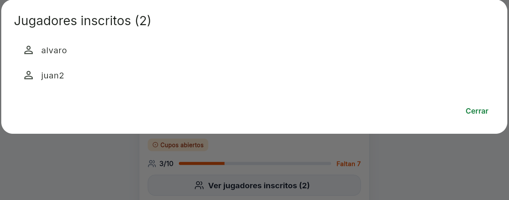
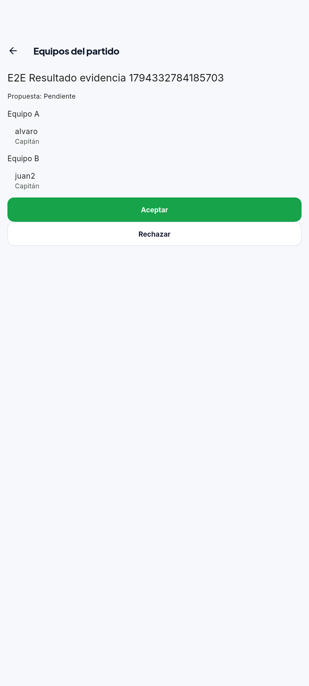
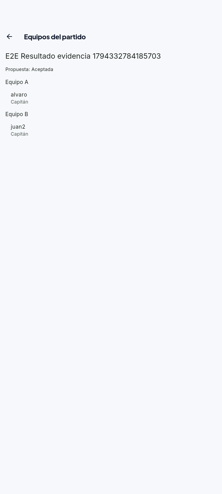
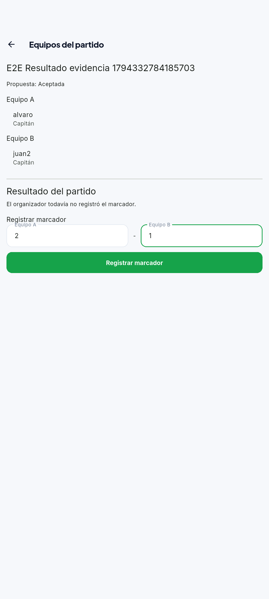
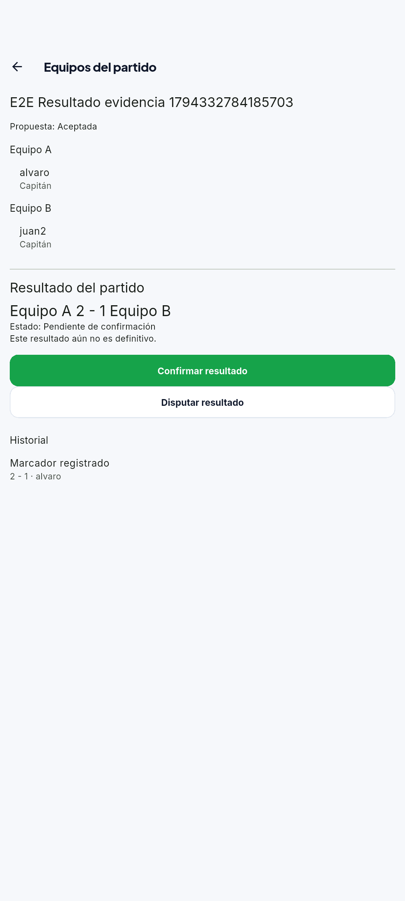
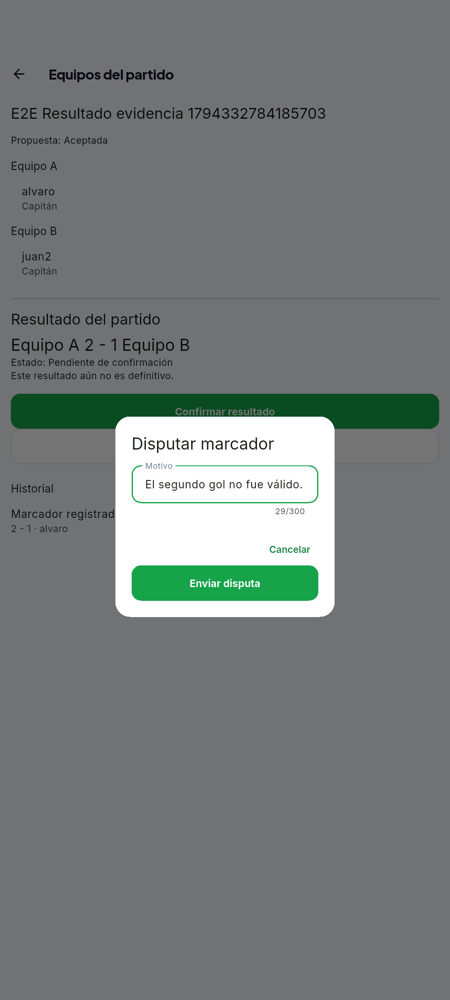
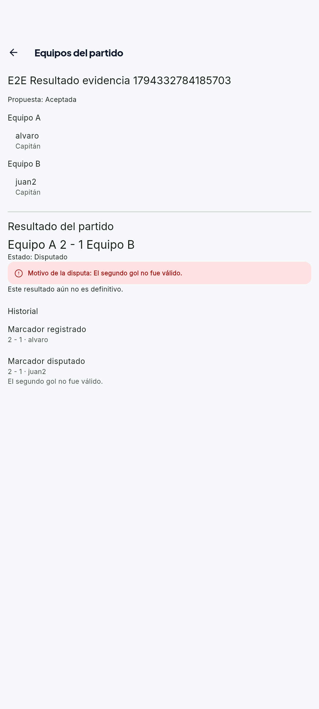
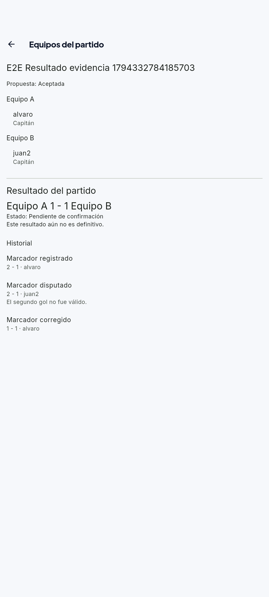
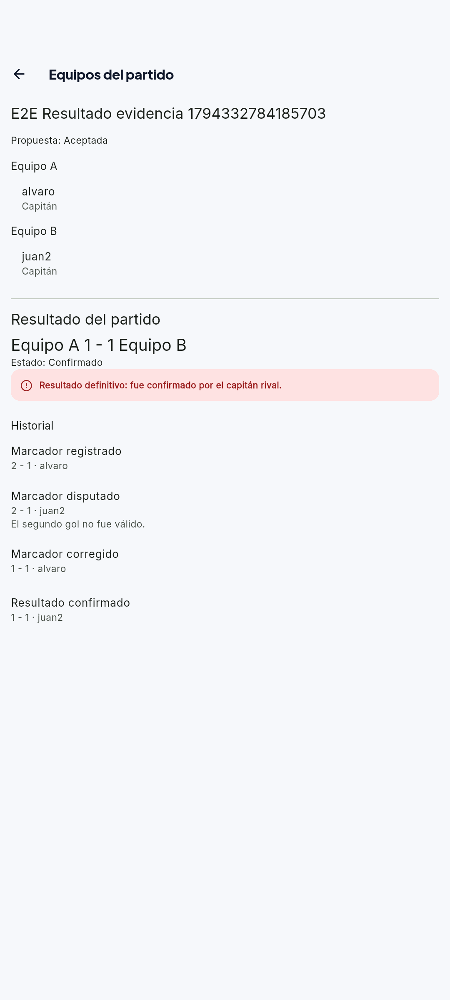

# Tarea 8 · Equipos y validación del resultado

**Proyecto:** UniSport.

**Fecha:** martes 10 de noviembre de 2026.

**Modalidad:** con IA.
**Integrantes:** Alvaro Sonco Guzman y Juan Carlos Laura Cespedes.

## 1. Funcionalidad asignada

UniSport debía incorporar un proceso nuevo con estados y acciones de dos
personas:

1. El organizador distribuye a todos los participantes entre los equipos A y B
   y selecciona al capitán rival.
2. El capitán rival acepta o rechaza la propuesta antes del partido.
3. Después del partido, el organizador registra el marcador.
4. El capitán rival confirma el marcador o lo disputa indicando un motivo.
5. Si existe una disputa, el organizador corrige el marcador y la corrección
   vuelve a quedar pendiente de confirmación.
6. Solo un resultado confirmado se considera definitivo y todas las acciones
   se conservan en el historial.

## 2. Antes

La aplicación permitía consultar los jugadores inscritos, pero no los separaba
en dos equipos, no definía capitanes y no tenía registro ni validación del
marcador.



Esta captura pertenece a la funcionalidad anterior del proyecto y sirve como
punto de comparación: `alvaro` y `juan2` aparecían solamente como integrantes
de una lista.

## 3. Implementación realizada

### Propuesta de equipos

- El organizador conserva su lugar en el Equipo A y selecciona el equipo de
  cada participante.
- Debe existir por lo menos una persona en el Equipo B.
- El capitán rival debe pertenecer al Equipo B y no puede ser el organizador.
- Cada participante aparece una sola vez.
- La propuesta queda **Pendiente** hasta que el capitán rival la acepte o la
  rechace.
- Una propuesta rechazada puede ser corregida y enviada nuevamente.

Las capturas reales corresponden al partido
`E2E Resultado evidencia 1794332784185703`, con `alvaro` como organizador y
capitán del Equipo A, y `juan2` como capitán del Equipo B. La propuesta y su
aceptación se realizaron desde la interfaz antes del inicio del partido.

### Resultado y validación

- El marcador solo puede registrarse después de la fecha del partido y cuando
  la propuesta de equipos fue aceptada.
- Solo el organizador puede registrar o corregir el marcador.
- Solo el capitán rival puede confirmarlo o disputarlo.
- Una disputa exige un motivo.
- Cada corrección genera una revisión nueva; una respuesta sobre una revisión
  anterior es rechazada.
- Los estados posibles son **Pendiente de confirmación**, **Disputado** y
  **Confirmado**.
- `esDefinitivo` solo es verdadero en el estado **Confirmado**.

El organizador registró `2 - 1`. El capitán rival disputó el marcador indicando
«El segundo gol no fue válido». El organizador corrigió a `1 - 1`, que volvió a
quedar **Pendiente de confirmación**, y el capitán rival confirmó la corrección.

La captura final muestra el estado **Confirmado**, el aviso de resultado
definitivo y la persistencia de estos eventos:

- `Marcador registrado · 2 - 1 · alvaro`.
- `Marcador disputado · 2 - 1 · juan2`, con el motivo de la disputa.
- `Marcador corregido · 1 - 1 · alvaro`.
- `Resultado confirmado · 1 - 1 · juan2`.

## 4. Capturas reales del recorrido

Las ocho capturas siguientes se tomaron directamente de la aplicación Flutter
en un emulador Android conectado a Supabase real el **10/11/2026**. Todas
corresponden al mismo partido y al mismo recorrido.

| Archivo | Contenido verificado |
|---|---|
| `tarea-8-propuesta-pendiente.png` | Equipos A y B con propuesta pendiente y botones Aceptar/Rechazar |
| `tarea-8-propuesta-aceptada.png` | Equipos aceptados con ambos capitanes |
| `tarea-8-registrar-marcador.png` | Formulario del organizador con el marcador 2 - 1 |
| `tarea-8-resultado-pendiente.png` | Marcador pendiente y acciones Confirmar/Disputar |
| `tarea-8-dialogo-disputa.png` | Diálogo para escribir el motivo |
| `tarea-8-resultado-disputado.png` | Estado Disputado, motivo y evento de disputa en el historial |
| `tarea-8-resultado-corregido.png` | Marcador 1 - 1 pendiente de nueva confirmación y evento de corrección |
| `tarea-8-resultado-confirmado.png` | Resultado definitivo e historial después de recargar |

















## 5. Comprobación de persistencia

Después de confirmar la corrección se volvió a abrir la pantalla del partido.
La captura final muestra el marcador `1 - 1`, el estado **Confirmado** y los
cuatro eventos conservados en Supabase: registro, disputa con motivo,
corrección y confirmación.

Para repetir el recorrido con dos cuentas, el organizador propone los equipos
y el capitán rival acepta antes del inicio. Después del partido, el organizador
registra el marcador; el capitán lo disputa con motivo; el organizador corrige
y el capitán confirma. Finalmente se vuelve a abrir la pantalla para comprobar
la persistencia del resultado y del historial.

La E2E `resultado_partido_flujo_test.dart` automatiza este recorrido completo:
reparte los equipos, selecciona al capitán rival, envía la propuesta y cambia
de cuenta para aceptarla desde la interfaz. La preparación en Supabase crea
únicamente el partido y la inscripción; deja los equipos sin proponer. El
partido se programa con cuatro minutos de margen para completar la aceptación
antes del inicio y se espera esa hora real antes de registrar el marcador.

## 6. Persistencia y permisos

[`esquema.sql`](../supabase/esquema.sql) incorpora:

- `resultados_partido`, que guarda el marcador vigente, su revisión y estado.
- `historial_resultados`, que conserva cada acción, actor, marcador, motivo y
  fecha.
- Políticas RLS para que solo los participantes consulten la información.
- Funciones transaccionales para registrar, disputar y confirmar.
- Bloqueo del resultado confirmado para que no vuelva a modificarse.

El esquema actualizado fue ejecutado en Supabase y el SQL Editor devolvió
`Success. No rows returned`, resultado esperado para la creación de tablas,
políticas y funciones.

## 7. Archivos principales afectados

- [`resultado_partido.dart`](../lib/modelos/resultado_partido.dart): estados,
  evento histórico y regla de resultado definitivo.
- [`vista_equipos.dart`](../lib/vistas/partidos/vista_equipos.dart): registro,
  disputa, corrección, confirmación e historial.
- [`repositorio_partidos.dart`](../lib/servicios/partidos/repositorio_partidos.dart):
  contrato de las operaciones.
- [`repositorio_partidos_supabase.dart`](../lib/servicios/partidos/repositorio_partidos_supabase.dart):
  consultas y llamadas RPC.
- [`esquema.sql`](../supabase/esquema.sql): persistencia, permisos y reglas en
  PostgreSQL.
- [`resultado_partido_test.dart`](../test/resultado_partido_test.dart): reglas,
  permisos y recorrido de interfaz.
- [`resultado_partido_flujo_test.dart`](../integration_test/resultado_partido_flujo_test.dart):
  E2E real con propuesta, aceptación, registro, disputa, corrección,
  confirmación y recarga desde la interfaz.
- [`resultado_partido_restricciones_test.dart`](../integration_test/resultado_partido_restricciones_test.dart):
  E2E real de permisos, respuesta duplicada y resultado definitivo.
- [`resultado_partido_e2e.dart`](../integration_test/apoyo/resultado_partido_e2e.dart):
  preparación y limpieza de datos compartida por las E2E. Las cuentas se
  reciben mediante `--dart-define`; las credenciales no se guardan en Git.
  El recorrido completo prepara un partido sin equipos; la E2E de
  restricciones conserva la preparación con equipos aceptados.

## 8. Verificación técnica

Se ejecutaron:

```powershell
flutter --suppress-analytics --no-version-check test --no-pub test/resultado_partido_test.dart
flutter test --no-pub -d emulator-5554 integration_test/resultado_partido_flujo_test.dart `
  --dart-define=E2E_ORGANIZADOR_CORREO=<correo> `
  --dart-define=E2E_ORGANIZADOR_CLAVE=<clave> `
  --dart-define=E2E_CAPITAN_CORREO=<correo> `
  --dart-define=E2E_CAPITAN_CLAVE=<clave>
flutter test --no-pub -d emulator-5554 integration_test/resultado_partido_restricciones_test.dart `
  --dart-define=E2E_ORGANIZADOR_CORREO=<correo> `
  --dart-define=E2E_ORGANIZADOR_CLAVE=<clave> `
  --dart-define=E2E_CAPITAN_CORREO=<correo> `
  --dart-define=E2E_CAPITAN_CLAVE=<clave>
flutter --suppress-analytics --no-version-check test --no-pub
flutter analyze --no-pub
```

**Resultado local:** las 3 pruebas de modelo e interfaz aprobaron. Las dos E2E
aprobaron en un emulador con Android 17 y Supabase real: una comprobó todo el
recorrido y la persistencia después de recargar; la otra comprobó permisos,
duplicados y el bloqueo del resultado definitivo. La suite completa terminó con
**144 pruebas aprobadas y 1 omitida** y `flutter analyze --no-pub` no encontró
incidencias. La prueba omitida corresponde a otra integración con Supabase que
requiere activación explícita.

El auxiliar de las E2E permite esperar la actualización del marcador sin
confundir el motivo de una disputa con un error de ejecución.

**Revalidación del recorrido completo (10/11/2026):**
`resultado_partido_flujo_test.dart` aprobó contra Supabase real en el emulador
Android (`All tests passed!`, 6 minutos y 16 segundos). Esta ejecución incluyó
la propuesta y la aceptación desde la interfaz, además del registro, disputa,
corrección, confirmación y comprobación del historial después de recargar.
La E2E `resultado_partido_restricciones_test.dart` también volvió a aprobar
(`All tests passed!`, 2 minutos y 15 segundos), verificando permisos, respuesta
única y bloqueo del resultado definitivo con el auxiliar compartido actualizado.
`flutter analyze --no-pub` terminó sin incidencias.

## 9. Commit

La funcionalidad, el esquema actualizado, las pruebas y esta evidencia quedaron
registrados en
[b054888 — feat: completar resultados y E2E de Tarea 8](https://github.com/alvaroSG34/Segundo-Proyecto-IHC/commit/b054888d320df6269d4aee4ff2ff2c5b3444993a).

Las ocho capturas reales, esta actualización del documento y el ajuste del
auxiliar E2E se incorporan en el commit de actualización de evidencia.
