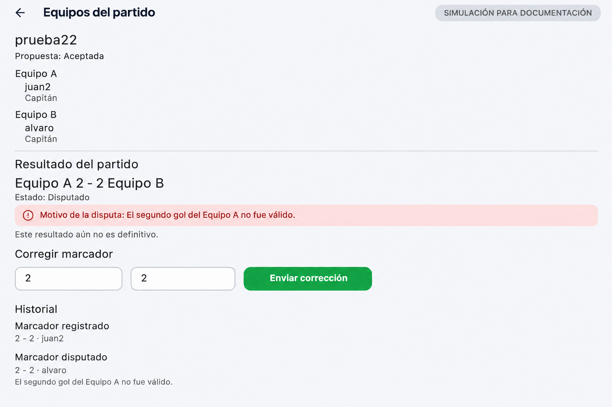
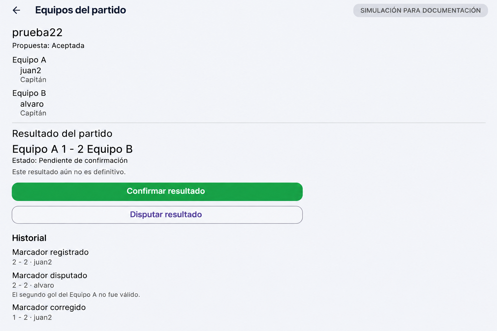

# Tarea 8 · Equipos y validación del resultado

**Proyecto:** UniSport.

**Fecha:** martes 10 de noviembre de 2026.

**Modalidad:** con IA.
**Integrantes:** Alvaro Sonco Guzman y Juan Carlos Laura Cespedes.

## 1. Funcionalidad asignada

UniSport debía incorporar un proceso nuevo con estados y acciones de dos
personas:

1. El organizador distribuye a todos los participantes entre los equipos A y B
   y selecciona al capitán rival.
2. El capitán rival acepta o rechaza la propuesta antes del partido.
3. Después del partido, el organizador registra el marcador.
4. El capitán rival confirma el marcador o lo disputa indicando un motivo.
5. Si existe una disputa, el organizador corrige el marcador y la corrección
   vuelve a quedar pendiente de confirmación.
6. Solo un resultado confirmado se considera definitivo y todas las acciones
   se conservan en el historial.

## 2. Antes

La aplicación permitía consultar los jugadores inscritos, pero no los separaba
en dos equipos, no definía capitanes y no tenía registro ni validación del
marcador.


Esta captura pertenece a la funcionalidad anterior del proyecto y sirve como
punto de comparación: `alvaro` y `juan2` aparecían solamente como integrantes
de una lista.

## 3. Implementación realizada

### Propuesta de equipos

- El organizador conserva su lugar en el Equipo A y selecciona el equipo de
  cada participante.
- Debe existir por lo menos una persona en el Equipo B.
- El capitán rival debe pertenecer al Equipo B y no puede ser el organizador.
- Cada participante aparece una sola vez.
- La propuesta queda **Pendiente** hasta que el capitán rival la acepte o la
  rechace.
- Una propuesta rechazada puede ser corregida y enviada nuevamente.

Las capturas aportadas muestran el partido `asd` con la convocatoria cerrada,
dos participantes y la propuesta aceptada. También muestran la pantalla de
edición, la selección de `juan2` como capitán del Equipo B y las acciones
**Aceptar** y **Rechazar** disponibles para esa persona.

### Resultado y validación

- El marcador solo puede registrarse después de la fecha del partido y cuando
  la propuesta de equipos fue aceptada.
- Solo el organizador puede registrar o corregir el marcador.
- Solo el capitán rival puede confirmarlo o disputarlo.
- Una disputa exige un motivo.
- Cada corrección genera una revisión nueva; una respuesta sobre una revisión
  anterior es rechazada.
- Los estados posibles son **Pendiente de confirmación**, **Disputado** y
  **Confirmado**.
- `esDefinitivo` solo es verdadero en el estado **Confirmado**.

Las capturas del partido `prueba22` muestran la propuesta aceptada, el formulario
de registro, el marcador `2 - 2`, el estado **Pendiente de confirmación**, las
acciones **Confirmar resultado** y **Disputar resultado**, y el diálogo que pide
el motivo de la disputa.

La captura final muestra el estado **Confirmado**, el aviso de resultado
definitivo y la persistencia de estos eventos:

- `Marcador registrado · 2 - 2 · juan2`.
- `Resultado confirmado · 2 - 2 · alvaro`.

## 4. Capturas nuevas por guardar en el repositorio

Las imágenes fueron aportadas durante la revisión, pero todavía no existen como
archivos dentro de `evidencias/`. Para enlazarlas definitivamente deben guardarse
con estos nombres:

| Archivo | Contenido que ya fue capturado |
|---|---|
| `tarea-8-propuesta-pendiente.png` | Equipos A y B con propuesta pendiente y botones Aceptar/Rechazar |
| `tarea-8-propuesta-aceptada.png` | Equipos aceptados con ambos capitanes |
| `tarea-8-registrar-marcador.png` | Formulario del organizador con el marcador 2 - 2 |
| `tarea-8-resultado-pendiente.png` | Marcador pendiente y acciones Confirmar/Disputar |
| `tarea-8-dialogo-disputa.png` | Diálogo para escribir el motivo |
| `tarea-8-resultado-confirmado.png` | Resultado definitivo e historial después de recargar |

Cuando los archivos estén guardados, se pueden incorporar con:

```markdown


```

## 5. Evidencia que falta para el recorrido obligatorio

Las capturas actuales prueban un recorrido de **registro → confirmación directa**.
Todavía no demuestran completamente el recorrido obligatorio **registro →
disputa → corrección → confirmación**, porque el historial final no contiene
los eventos `Marcador disputado` y `Marcador corregido`.

Faltan dos capturas:

1. `tarea-8-resultado-disputado.png`: estado **Disputado**, motivo visible y
   evento **Marcador disputado** en el historial.
2. `tarea-8-resultado-corregido.png`: marcador corregido, estado **Pendiente de
   confirmación** y evento **Marcador corregido** en el historial.

La captura final debe realizarse después de esa corrección y mostrar los cuatro
eventos: registrado, disputado, corregido y confirmado.

### Mockups generados para preparar la evidencia

Las siguientes imágenes son **simulaciones para documentación**. Ayudan a
visualizar las dos pantallas que faltan y a saber qué debe aparecer cuando se
repita el recorrido, pero **no reemplazan las capturas reales de la aplicación
conectada a Supabase**.





Para producir la evidencia válida se debe usar un partido nuevo: registrar un
marcador, ingresar como capitán rival para disputarlo, volver como organizador
para corregirlo y finalmente ingresar otra vez como capitán rival para
confirmarlo. El partido anterior ya quedó confirmado y, por regla de negocio,
su resultado es definitivo.

## 6. Persistencia y permisos

[`esquema.sql`](../supabase/esquema.sql) incorpora:

- `resultados_partido`, que guarda el marcador vigente, su revisión y estado.
- `historial_resultados`, que conserva cada acción, actor, marcador, motivo y
  fecha.
- Políticas RLS para que solo los participantes consulten la información.
- Funciones transaccionales para registrar, disputar y confirmar.
- Bloqueo del resultado confirmado para que no vuelva a modificarse.

El esquema actualizado fue ejecutado en Supabase y el SQL Editor devolvió
`Success. No rows returned`, resultado esperado para la creación de tablas,
políticas y funciones.

## 7. Archivos principales afectados

- [`resultado_partido.dart`](../lib/modelos/resultado_partido.dart): estados,
  evento histórico y regla de resultado definitivo.
- [`vista_equipos.dart`](../lib/vistas/partidos/vista_equipos.dart): registro,
  disputa, corrección, confirmación e historial.
- [`repositorio_partidos.dart`](../lib/servicios/partidos/repositorio_partidos.dart):
  contrato de las operaciones.
- [`repositorio_partidos_supabase.dart`](../lib/servicios/partidos/repositorio_partidos_supabase.dart):
  consultas y llamadas RPC.
- [`esquema.sql`](../supabase/esquema.sql): persistencia, permisos y reglas en
  PostgreSQL.
- [`resultado_partido_test.dart`](../test/resultado_partido_test.dart): reglas,
  permisos y recorrido de interfaz.
- [`resultado_partido_flujo_test.dart`](../integration_test/resultado_partido_flujo_test.dart):
  E2E real con registro, disputa, corrección, confirmación y recarga.
- [`resultado_partido_restricciones_test.dart`](../integration_test/resultado_partido_restricciones_test.dart):
  E2E real de permisos, respuesta duplicada y resultado definitivo.
- [`resultado_partido_e2e.dart`](../integration_test/apoyo/resultado_partido_e2e.dart):
  preparación y limpieza de datos compartida por las E2E. Las cuentas se
  reciben mediante `--dart-define`; las credenciales no se guardan en Git.

## 8. Verificación técnica

Se ejecutaron:

```powershell
flutter --suppress-analytics --no-version-check test --no-pub test/resultado_partido_test.dart
flutter test --no-pub -d emulator-5554 integration_test/resultado_partido_flujo_test.dart `
  --dart-define=E2E_ORGANIZADOR_CORREO=<correo> `
  --dart-define=E2E_ORGANIZADOR_CLAVE=<clave> `
  --dart-define=E2E_CAPITAN_CORREO=<correo> `
  --dart-define=E2E_CAPITAN_CLAVE=<clave>
flutter test --no-pub -d emulator-5554 integration_test/resultado_partido_restricciones_test.dart `
  --dart-define=E2E_ORGANIZADOR_CORREO=<correo> `
  --dart-define=E2E_ORGANIZADOR_CLAVE=<clave> `
  --dart-define=E2E_CAPITAN_CORREO=<correo> `
  --dart-define=E2E_CAPITAN_CLAVE=<clave>
flutter --suppress-analytics --no-version-check test --no-pub
flutter analyze --no-pub
```

**Resultado local:** las 3 pruebas de modelo e interfaz aprobaron. Las dos E2E
aprobaron en un emulador con Android 17 y Supabase real: una comprobó todo el
recorrido y la persistencia después de recargar; la otra comprobó permisos,
duplicados y el bloqueo del resultado definitivo. La suite completa terminó con
**144 pruebas aprobadas y 1 omitida** y `flutter analyze --no-pub` no encontró
incidencias. La prueba omitida corresponde a otra integración con Supabase que
requiere activación explícita.

## 9. Commit

**Pendiente:** crear el commit que incluya la funcionalidad, las pruebas, el
esquema actualizado, este documento y las capturas guardadas en `evidencias/`.
