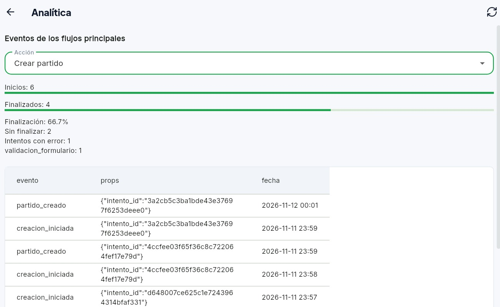
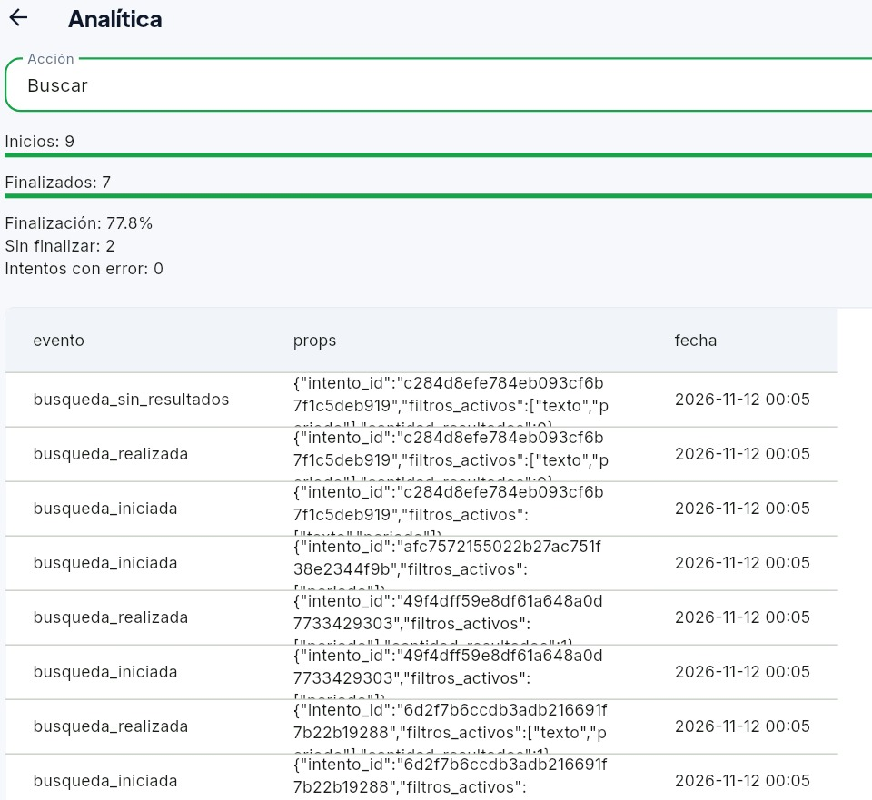

# Tarea 9 · Analítica y baja con plazo en UniSport

**Proyecto:** UniSport.  
**Fecha:** 11 de noviembre de 2026.

**Modalidad:** con IA.
**Integrantes:** Alvaro Sonco Guzman y Juan Carlos Laura Cespedes.

## Parte A · Analítica de los flujos

Registrar acciones para conocer qué tareas se completan y dónde aparecen dificultades, recopilando únicamente los datos necesarios. Los 11 flujos acordados se presentan como 14 acciones, con 47 nombres de eventos permitidos. La pantalla Analítica conserva su tabla y añade un selector con un embudo Inicio → Finalización, dos barras y errores.

## Flujos y eventos implementados

Los eventos de éxito se envían después de que el repositorio o servicio confirma la operación.

**Base** significa `intento_id`; los eventos de error añaden `codigo_error`. Los tipos y valores permitidos se detallan en Datos recopilados.

| Acción | Dónde se inicia el intento | Eventos: inicio → finalización; error | Props | Pregunta que responde |
| --- | --- | --- | --- | --- |
| Unirse | Pulsar Unirme, antes del diálogo. | `union_iniciada` → `partido_unido`; `union_fallida` | Base y `partido_id`. | ¿Cuántos intentos terminan en una inscripción? |
| Crear partido | Abrir el formulario de creación. | `creacion_iniciada` → `partido_creado`; `creacion_fallida` | Base. | ¿Cuántos formularios abiertos llegan a guardar un partido? |
| Buscar | Cambiar filtros y esperar 500 ms sin otro cambio, antes de consultar. | `busqueda_iniciada` → `busqueda_realizada`; `busqueda_fallida`. Una respuesta vacía añade `busqueda_sin_resultados`. | Base, `filtros_activos` y, al completar, `cantidad_resultados`. | ¿Cuántas consultas se completan y cuántas no encuentran partidos? |
| Registrarse | Abrir el formulario de registro. | `registro_iniciado` → `registro_completado`; `registro_fallido` | Base. | ¿Cuántos intentos de registro completan el acceso? |
| Iniciar sesión | Abrir el formulario de acceso. | `login_iniciado` → `login_exitoso`; `login_fallido` | Base. | ¿Cuántos intentos de acceso llegan al menú privado? |
| Salir | Pulsar Salir, antes del diálogo. | `salida_iniciada` → `salida_completada`; `salida_fallida` | Base y `anticipacion` opcional al completar. | ¿Cuántas salidas se confirman y con qué anticipación? |
| Entrar en espera | Pulsar Entrar como suplente. | `espera_iniciada` → `espera_confirmada`; `espera_fallida`. El servidor registra `suplente_promovido` por separado. | Base; la promoción usa `{}`. | ¿Cuántos intentos llegan a la lista y cuántas promociones ocurren? |
| Reprogramar | Abrir el formulario de reprogramación. | `reprogramacion_iniciada` → `partido_reprogramado`; `reprogramacion_fallida` | Base. | ¿Cuántos cambios de fecha o cancha llegan a guardarse? |
| Reconfirmar | Pulsar Confirmar asistencia o Retirarme, antes del diálogo si corresponde. | `reconfirmacion_iniciada` → `reprogramacion_aceptada` o `reprogramacion_rechazada`; `reconfirmacion_fallida` | Base. | ¿Cuántos intentos terminan en aceptar o rechazar el cambio? |
| Responder propuesta | Pulsar Aceptar o Rechazar. | `respuesta_propuesta_iniciada` → `propuesta_aceptada` o `propuesta_rechazada`; `respuesta_propuesta_fallida` | Base. | ¿Cuántas respuestas del capitán quedan guardadas? |
| Validar resultado | Pulsar Confirmar resultado o Disputar resultado, antes de escribir el motivo. | `validacion_resultado_iniciada` → `resultado_confirmado` o `resultado_disputado`; `validacion_resultado_fallida` | Base. | ¿Cuántos intentos terminan en confirmación o disputa? |
| Editar | Abrir el formulario de edición. | `edicion_iniciada` → `partido_editado`; `edicion_fallida` | Base. | ¿Cuántas ediciones iniciadas terminan guardando los cambios? |
| Eliminar | Pulsar Eliminar, antes del diálogo. | `eliminacion_iniciada` → `partido_eliminado`; `eliminacion_fallida` | Base. | ¿Cuántos intentos confirman la eliminación? |
| Recuperar contraseña | Abrir el formulario de recuperación. | `recuperacion_iniciada` → `recuperacion_solicitada`; `recuperacion_fallida` | Base. | ¿Cuántas solicitudes son aceptadas por el servicio? |

Se añadieron 18 nombres para completar los inicios y errores que faltaban. No se registran eventos adicionales de cancelación, cada pantalla abierta ni cada clic. Se mantienen omitidos `salida_cancelada`, `propuesta_guardada` y `resultado_registrado`.

Las preguntas del plan son: ¿cuántos intentos de cada acción llegan a finalizar?, ¿qué proporción queda sin finalización observada? y ¿qué códigos de error aparecen? En búsquedas se añade ¿cuántas consultas terminan vacías?; en Lista de espera, ¿cuántos suplentes fueron promovidos? Las propiedades de cada familia se detallan a continuación: todas las acciones usan `intento_id`, los errores añaden `codigo_error`, y únicamente búsqueda, unión y salida tienen las propiedades adicionales indicadas.

## Datos recopilados

Los registros incluyen `evento`, `props` y `fecha`, que también aparecen en la pantalla **Analítica**.

| Propiedad | Uso |
| --- | --- |
| `intento_id` | Identificador aleatorio de 32 caracteres hexadecimales por formulario, acción o consulta. Relaciona inicio, errores y finalización sin identificar cuentas o dispositivos. Los reintentos del formulario conservan el ID; las nuevas acciones generan otro. |
| `codigo_error` | Motivo de una lista fija, únicamente en los flujos que registran fallos. |
| `filtros_activos` | Tipos de filtros utilizados: `texto`, `deporte`, `fecha`, `lugar`, `cupos` y `periodo`. No incluye sus valores. |
| `cantidad_resultados` | Número de partidos devueltos por una búsqueda completada. |
| `anticipacion` | Categoría temporal de una salida completada, si se conoce la fecha del partido. |
| `partido_id` | Se conserva únicamente en el seguimiento original de unión a un equipo. Los flujos nuevos no lo recopilan. |

Los códigos de error permitidos son `validacion_formulario`, `regla_negocio`, `persistencia_fallida`, `consulta_fallida`, `carga_lugares_fallida`, `servicio_autenticacion` y `servicio_partidos`, según el flujo.

La anticipación puede ser `partido_iniciado`, `menos_1_hora`, `entre_1_y_24_horas` o `mas_24_horas`. No se guarda la fecha exacta del partido en esta propiedad.

`suplente_promovido` usa `props: {}`: para contar promociones no se necesita identificar al suplente ni al partido.

## Datos que decidimos no recopilar

En los flujos nuevos se excluyeron nombres, correos, contraseñas, IDs de cuentas o partidos, títulos, ubicaciones, fechas consultadas, texto de búsqueda, motivos escritos, marcadores, distribución de jugadores, enlaces, tokens y mensajes completos de error. No son necesarios para las preguntas planteadas.

Los nuevos registros tampoco guardan `usuario_id`. La columna histórica sigue existiendo por compatibilidad y los registros anteriores conservan su valor; no se eliminaron esos datos.

## Funcionamiento y protección de datos

- Se reutilizan `crearIntentoId` y `registrarEvento` del [servicio de analítica](../lib/servicios/analitica/servicio_analitica.dart). Los envíos son independientes, en segundo plano y toleran hasta 15 segundos de respuesta para conexiones lentas. Los fallos de analítica no bloquean la tarea.
- La búsqueda espera 500 ms sin cambios antes de consultar y registrar el inicio. No registra cada pulsación, la carga inicial ni las recargas automáticas; descarta respuestas antiguas. Una búsqueda ya iniciada que sea sustituida puede quedar sin finalización observada.
- Supabase valida los nombres de eventos y las propiedades de los flujos nuevos mediante listas cerradas. La tabla `eventos` no permite acceso directo al cliente.
- Sin sesión se permiten los nueve eventos de registro, login y recuperación: inicio, finalización y error de cada acción. Los demás eventos y la consulta de analítica requieren autenticación.
- `suplente_promovido` se genera en el servidor al salir un titular o rechazar una reprogramación con suplentes en espera. Funciona aunque el suplente tenga la aplicación cerrada y se rechaza su envío desde el cliente. Un fallo de analítica no impide la promoción.
- Cancelar no genera éxitos. Rechazar una reprogramación no añade eventos del flujo Salir; si entra un suplente, se registra su promoción por separado.

## Lectura de resultados y límites

El panel empieza en Crear partido y permite seleccionar las 14 acciones. Cuenta IDs distintos, no filas: los finalizados son la intersección entre IDs de inicio y de finalización; la tasa es finalizados / inicios × 100. Sin inicios muestra «Sin datos». Los intentos sin finalizar son inicios − finalizados. Los duplicados y los finales sin inicio relacionado no inflan las métricas; los registros históricos permanecen en la tabla.

La tabla muestra únicamente los eventos de la acción seleccionada. Buscar incluye las búsquedas sin resultados y Entrar en espera incluye las promociones de suplentes.

Los errores cuentan intentos iniciados distintos y se agrupan por código fijo. Un intento puede tener un error y después finalizar; un mismo intento también puede aparecer bajo varios códigos, por lo que no se deben sumar las categorías para calcular el total. Rechazar propuestas o reprogramaciones y disputar resultados son decisiones finalizadas, no caídas.

Las métricas usan los eventos cargados; no se han añadido filtros de fechas ni exportaciones. Se retiraron del panel el resumen de mayor caída y el párrafo explicativo inferior.

Para calcular búsquedas vacías se divide `busqueda_sin_resultados` entre `busqueda_realizada`: una consulta vacía genera ambos eventos, por lo que no deben sumarse como búsquedas diferentes.

Las decisiones se relacionan con su intento, pero no con propuestas o partidos concretos. Un intento sin finalizar no representa automáticamente un jugador pendiente ni un abandono. Las promociones son un conteo adicional de Lista de espera y no permiten calcular tiempos de espera.

`registro_completado` representa registro y acceso completados; si se exige confirmar el correo y el servicio no completa el acceso, se registra un fallo. `recuperacion_solicitada` mide la aceptación de la solicitud, no acredita recepción del correo ni cambio de contraseña.

No hay cola persistente ni reintentos automáticos. Los eventos pueden perderse o llegar en distinto orden; un inicio sin éxito no demuestra por sí solo abandono o cancelación.

## Resultados observados y mejora propuesta

Se consultó una instantánea real de **107 eventos de Supabase** el 11 de noviembre de 2026. La siguiente tabla usa el mismo cálculo por `intento_id` que el panel. Son datos de las pruebas disponibles, no una medición representativa de estudiantes usando la aplicación.

| Acción | Inicios | Finalizados | Sin finalizar | Sin finalizar (%) |
| --- | ---: | ---: | ---: | ---: |
| Unirse | 3 | 2 | 1 | 33,3 % |
| Crear partido | 3 | 2 | 1 | 33,3 % |
| Buscar | 5 | 4 | 1 | 20,0 % |
| Registrarse | 1 | 0 | 1 | 100,0 % |
| Iniciar sesión | 17 | 14 | 3 | 17,6 % |
| Salir | 2 | 1 | 1 | 50,0 % |
| Entrar en espera | 0 | 0 | 0 | Sin datos |
| Reprogramar | 2 | 2 | 0 | 0,0 % |
| Reconfirmar | 4 | 3 | 1 | 25,0 % |
| Responder propuesta | 0 | 0 | 0 | Sin datos |
| Validar resultado | 0 | 0 | 0 | Sin datos |
| Editar | 2 | 0 | 2 | 100,0 % |
| Eliminar | 2 | 1 | 1 | 50,0 % |
| Recuperar contraseña | 1 | 0 | 1 | 100,0 % |

**Paso con mayor caída observada: Editar, de Inicio a Finalización.** Tiene dos intentos sin finalizar y un intento con `validacion_formulario`. Comparte el 100 % con Registro y Recuperación, pero tiene más intentos sin finalizar. Login tiene más intentos sin finalizar en cantidad absoluta —tres—, aunque su proporción es menor.

Las ejecuciones incluyeron validaciones y cancelaciones intencionales, así como interrupciones de pruebas. Por eso este resultado no demuestra que el formulario de edición impida guardar ni que los usuarios lo abandonen. Las acciones sin inicios relacionados muestran «Sin datos»; no se interpretan como una tasa de finalización del 0 %.

**Qué cambiaríamos:** mostrar antes del envío los requisitos del título y el mínimo de dos jugadores junto a sus campos, conservando los valores al corregir un error. Después repetiríamos la tarea de edición y compararíamos los intentos con `validacion_formulario` y la tasa de finalización. Esta es una mejora propuesta, no un cambio adicional implementado en esta entrega.

Esta instantánea es independiente del supuesto de aprobación de las E2E descrito más abajo: asumir que las pruebas terminaron correctamente no añade eventos a la base ni modifica los conteos observados.

## Capturas de la evidencia

Las siguientes capturas muestran el estado real del panel el 12 de noviembre de 2026. Sus valores difieren de la instantánea anterior porque se generaron nuevos eventos durante la verificación.

### 1. Panel de Crear partido



La captura permite comprobar que el resumen distingue **6 inicios**, **4 finalizaciones**, **2 intentos sin finalizar** y **1 intento con error de validación**. La tasa observada es de **66,7 %** y la tabla contiene únicamente eventos `creacion_iniciada` y `partido_creado`.

### 2. Cambio de acción y tabla filtrada



La captura permite comprobar que cambiar la acción actualiza las métricas y las filas sin mostrar eventos de creación. Se observan **9 inicios**, **7 finalizaciones**, **2 intentos sin finalizar**, **0 errores** y una tasa de **77,8 %**. La tabla incluye `busqueda_iniciada`, `busqueda_realizada` y `busqueda_sin_resultados`; una búsqueda vacía completada sigue contando como finalización.

## Verificación realizada

La última suite local completa terminó con **241 pruebas aprobadas y 1 integración opcional omitida**. Las pruebas de analítica también pasaron después de retirar el párrafo inferior y filtrar la tabla por la acción seleccionada. `flutter analyze` terminó sin problemas.

Las pruebas cubren confirmación del servidor, errores, cancelaciones, reintentos, respuestas pendientes, propiedades sin datos privados y fallos de analítica que no impiden completar acciones. Las pruebas locales de recuperación no envían correos reales.

```sh
flutter analyze
flutter test
```

La [prueba de integración con Supabase](../test/supabase_integracion_test.dart) conserva el flujo original entre dos cuentas, la comprobación de eventos de unión y la restricción de acceso directo a la tabla. Sus llamadas de unión ahora comparten `intento_id`.

Las 12 E2E que recorren estas acciones consultan los eventos reales mediante un observador autenticado separado. Al terminar, cada acción debe tener al menos un inicio nuevo y una finalización con el mismo ID; cancelar no satisface la comprobación. Se pasan `E2E_ORGANIZADOR_CORREO` y `E2E_ORGANIZADOR_CLAVE`, además de las variables que ya pide cada prueba. El registro conserva su requisito de confirmación automática de correo. Las credenciales no se guardan en el repositorio.

**Supuesto de cierre acordado:** se consideran aprobadas las 12 E2E que cubren las 14 acciones, según la indicación del usuario. Se deja explícito como supuesto; no representa una nueva ejecución completa registrada. Los registros realmente obtenidos confirman cinco E2E aprobadas: reprogramación/reconfirmación, creación, eliminación, unión y salida. Las demás ejecuciones no quedaron cerradas antes del bloqueo del emulador.

| Prueba E2E | Acciones verificadas por sus comprobaciones de tracks |
| --- | --- |
| [crear_partido_test.dart](../integration_test/crear_partido_test.dart) | Crear partido. |
| [unirse_partido_test.dart](../integration_test/unirse_partido_test.dart) | Unirse. |
| [explorar_partidos_test.dart](../integration_test/explorar_partidos_test.dart) | Buscar y filtrar. |
| [registro_test.dart](../integration_test/registro_test.dart) | Registrarse. |
| [login_test.dart](../integration_test/login_test.dart) | Iniciar sesión. |
| [salir_partido_test.dart](../integration_test/salir_partido_test.dart) | Salir. |
| [flujo_suplentes_test.dart](../integration_test/flujo_suplentes_test.dart) | Entrar en espera, promoción del suplente y baja tardía visible para el organizador. |
| [reprogramar_partido_test.dart](../integration_test/reprogramar_partido_test.dart) | Reprogramar y reconfirmar; comprueba también la promoción del suplente. |
| [resultado_partido_flujo_test.dart](../integration_test/resultado_partido_flujo_test.dart) | Responder propuesta y validar resultado. |
| [editar_partido_test.dart](../integration_test/editar_partido_test.dart) | Editar. |
| [eliminar_partido_test.dart](../integration_test/eliminar_partido_test.dart) | Eliminar. |
| [recuperar_clave_test.dart](../integration_test/recuperar_clave_test.dart) | Recuperar contraseña: aceptación de la solicitud, sin comprobar entrega del correo. |

## E2E de reprogramación y reconfirmación

La prueba [reprogramar_partido_test.dart](../integration_test/reprogramar_partido_test.dart) usa tres cuentas existentes, confirmadas y con perfil: organizador, titular y suplente. Prepara un partido temporal y recorre la interfaz para cambiar fecha y cancha, aceptar, cancelar un retiro, rechazar y reconfirmar con el suplente promovido desde Explorar. Al reabrir comprueba la fecha, cancha, cupos y participantes guardados. El partido se elimina al terminar, incluso si falla la prueba.

También consulta los eventos reales y compara los conteos antes y después: dos `partido_reprogramado`, dos `reprogramacion_aceptada`, un `reprogramacion_rechazada` y un `suplente_promovido`. Espera los envíos en segundo plano y comprueba que cancelar el retiro no registre un rechazo. Los eventos anónimos permanecen en analítica después de limpiar el partido.

Ejecutarla con el esquema actualizado y sin otras personas o pruebas generando esos eventos simultáneamente: los conteos de analítica son globales y no identifican al partido. Esta prueba verifica esos cuatro tipos de evento; las otras acciones se comprueban en sus E2E correspondientes.

```powershell
flutter test integration_test/reprogramar_partido_test.dart -d <dispositivo> `
  --dart-define=E2E_ORGANIZADOR_CORREO=<correo> `
  --dart-define=E2E_ORGANIZADOR_CLAVE=<clave> `
  --dart-define=E2E_TITULAR_CORREO=<correo> `
  --dart-define=E2E_TITULAR_CLAVE=<clave> `
  --dart-define=E2E_SUPLENTE_CORREO=<correo> `
  --dart-define=E2E_SUPLENTE_CLAVE=<clave>
```

Validación local de esta incorporación: 13 pruebas de reprogramación y su analítica aprobadas.

Después de actualizar el esquema en Supabase, la E2E se ejecutó en el emulador Android Pixel 8 y terminó con **1 prueba aprobada**. Verificó reprogramación, aceptación, cancelación, rechazo, promoción, fecha, cancha, cupos y participantes persistidos, además de los seis tracks esperados: dos reprogramaciones, dos aceptaciones, un rechazo y una promoción. También terminó correctamente la limpieza del entorno de pruebas. El análisis estático del archivo no reportó problemas. Las credenciales de las cuentas no se guardan en este documento ni en el repositorio.

## Activación en Supabase

Toda la configuración está centralizada en [supabase/esquema.sql](../supabase/esquema.sql). El esquema actualizado, incluida la tabla `bajas_tardias` y la función `obtener_bajas_tardias_organizador`, fue aplicado en la base remota antes de ejecutar la E2E de la Parte B.

Para instalar o actualizar la base, abrir el SQL Editor del proyecto de Supabase, pegar el contenido completo de ese archivo y ejecutarlo. El esquema incluye las tablas, permisos, validaciones y funciones actuales, además de los ajustes de compatibilidad para bases existentes.

Después de aplicar el SQL, completar acciones y cancelar otras desde la aplicación; comprobar en Analítica que solo aparezcan los eventos acordados y las propiedades permitidas.

## Parte B · Darse de baja con plazo

### Regla seleccionada

UniSport permite que un jugador abandone un partido. Si faltan **2 horas o más**, la salida es normal; si faltan **menos de 2 horas**, la persona sale, pero la acción queda registrada como **baja tardía** y es visible para el organizador. El organizador no puede darse de baja de su propio partido. Cuando existe una lista de espera, el primer suplente ocupa automáticamente la plaza liberada.

### Implementación

- [ModeloPartido](../lib/modelos/modelo_partido.dart) determina la frontera de dos horas mediante `esBajaTardia`. Exactamente dos horas todavía cuenta como salida a tiempo.
- [salir_del_partido](../supabase/esquema.sql) bloquea la fila del partido, valida la sesión y registra la baja tardía dentro de la misma transacción que elimina la inscripción. Así no puede existir una baja registrada sin salida ni una salida tardía sin registro.
- La tabla `bajas_tardias` conserva partido, jugador, nombre y momento de la salida. No permite acceso directo desde el cliente.
- `obtener_bajas_tardias_organizador` devuelve únicamente registros de partidos organizados por la sesión actual.
- En Explorar y Mis partidos, el diálogo avisa antes de confirmar cuando faltan menos de dos horas y usa la acción **Registrar baja tardía**.
- En Mis partidos, el organizador dispone del botón **Ver bajas tardías (n)**, con el nombre y la fecha de cada registro.
- La promoción del primer suplente se mantiene tanto para una salida a tiempo como para una baja tardía. Si no hay suplentes, el cupo queda libre.

### Decisiones de interacción

La salida tardía no se bloquea porque impedir retirarse dejaría información incorrecta sobre quién asistirá. En cambio, el diálogo explica la consecuencia antes de confirmar y el organizador recibe un registro visible. No se muestra la lista a otros jugadores ni se expone directamente la tabla de la base de datos.

### Pruebas

Las pruebas locales verifican:

1. Salida a tiempo con promoción del primer suplente.
2. Registro de una salida dentro de las dos horas.
3. Frontera exacta: `2:00` no es tardía y `1:59` sí.
4. Privacidad: el jugador no consulta el registro y el organizador sí.
5. Visualización del botón, diálogo, nombre y fecha para el organizador.
6. El organizador no puede salir de su propio partido.
7. Los flujos de salida, espera, filtros y analítica existentes continúan funcionando.

La suite completa local terminó con **241 pruebas aprobadas y 1 integración opcional omitida**. El análisis estático terminó con **No issues found**.

```sh
flutter analyze
flutter test
```

### E2E de la funcionalidad

La prueba [flujo_suplentes_test.dart](../integration_test/flujo_suplentes_test.dart) contiene las dos demostraciones solicitadas:

1. Crea un partido, llena el último cupo, agrega un suplente, realiza una salida a tiempo y comprueba que el primer suplente asciende.
2. Crea un segundo partido a 90 minutos del inicio, une al titular, confirma **Registrar baja tardía**, vuelve con la cuenta organizadora y comprueba **Ver bajas tardías (1)**.

La E2E se ejecutó el **12 de noviembre de 2026** en el emulador Android con tres cuentas reales y el esquema actualizado. Terminó con **1 prueba aprobada** (`All tests passed`) en **2 min 23 s**. Verificó la promoción del primer suplente tras una salida a tiempo, el registro de una baja dentro de las dos horas, su visualización para el organizador y el par de eventos de entrada en espera con el mismo `intento_id`. Los partidos temporales fueron eliminados al finalizar y las credenciales no se guardaron en el repositorio.

```powershell
flutter test integration_test/flujo_suplentes_test.dart -d <dispositivo> `
  --dart-define=E2E_ORGANIZADOR_CORREO=<correo> `
  --dart-define=E2E_ORGANIZADOR_CLAVE=<clave> `
  --dart-define=E2E_TITULAR_CORREO=<correo> `
  --dart-define=E2E_TITULAR_CLAVE=<clave> `
  --dart-define=E2E_SUPLENTE_CORREO=<correo> `
  --dart-define=E2E_SUPLENTE_CLAVE=<clave>
```
